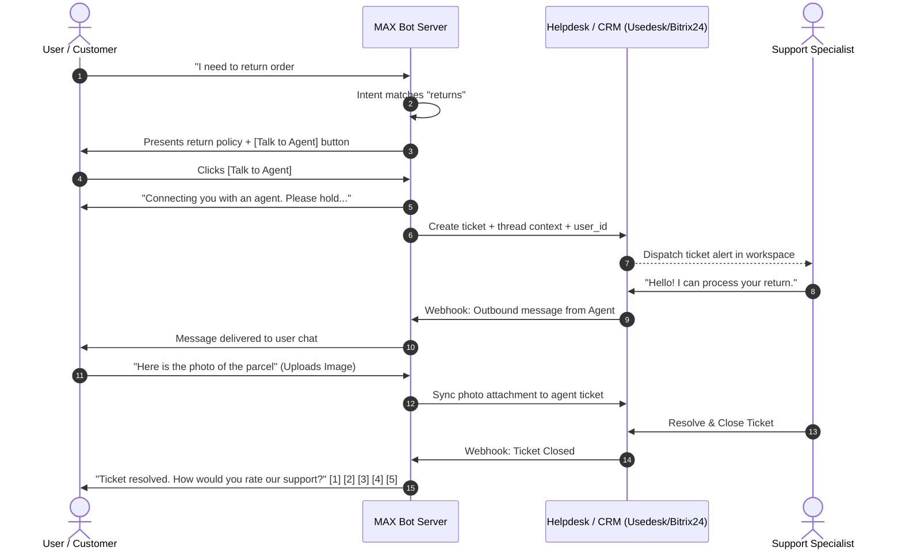
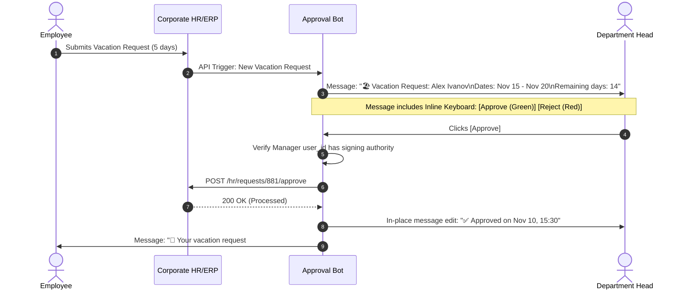
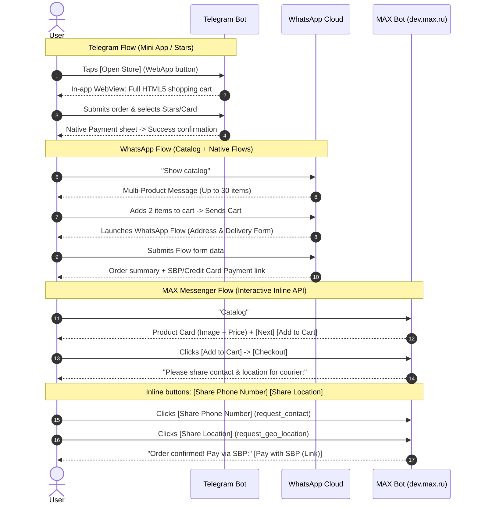

# Modern Bot Ecosystem Research: Platform Capabilities, Architectural Patterns, and Enterprise Use Cases

> **Target Systems:** Telegram, WhatsApp Cloud API, VK Bot API, MAX Messenger (`dev.max.ru`), Slack, Discord  
> **Target Audience:** System Architects, Bot Engineers, and SDK Developers for `max-bot-api-client`  
> **Output Artifact:** `docs/research/bot-use-cases-and-platform-patterns.md`  
> **Status:** Production-Ready Research Reference  

---

## 1. Executive Summary & Research Scope

Messaging platforms have evolved from basic plain-text message routers into complete application runtimes and transaction ecosystems. In 2026, bots serve as mission-critical interfaces for customer support, digital commerce, enterprise workflow automation, community security, and AI agent orchestration.

This research paper provides an exhaustive, comparative analysis of bot platform capabilities, architectural patterns, and real-world implementations across five major messaging ecosystems:
1. **Telegram Bot API:** The de facto standard for open, feature-rich consumer and community bots (Mini Apps, Telegram Stars, Forum Topics, Telegram Business).
2. **WhatsApp Business Platform (Cloud API):** The enterprise standard for verified corporate customer engagement (Conversation-based pricing, WhatsApp Flows, Interactive Messages, Catalog integrations).
3. **VK Bot API:** The dominant domestic social network bot ecosystem in the CIS (Carousels, VK Mini Apps, VK Pay, LongPoll / Callback APIs).
4. **MAX Messenger Bot API (`dev.max.ru`):** The emerging Russian enterprise and super-app platform (Gosuslugi / business verification, Russian Trusted Root CA TLS, inline callbacks, contact/geo sharing).
5. **Slack & Discord:** The gold standards for enterprise workplace collaboration and real-time community engagement (Block Kit, Modals, Action Rows, slash commands).

The objective is to catalog best-in-class architectural patterns, extract user-interaction flows, contrast commercial/pricing models, and formulate strategic design recommendations for the **`max-bot-api-client`** repository.

---

## 2. Platform Capabilities & Architecture Deep-Dive

### 2.1 Telegram Bot API

Telegram’s bot platform ([core.telegram.org/bots/api](https://core.telegram.org/bots/api)) offers arguably the most flexible and open developer platform in the messaging landscape, with zero messaging fees and rich multimedia primitives.

#### Key Platform Primitives
* **Custom & Inline Keyboards:**
  * `ReplyKeyboardMarkup`: Replaces the client's virtual keyboard with structured buttons (text, contact request, location request, poll creation, WebApp launcher).
  * `InlineKeyboardMarkup`: Embeds interactive buttons directly below specific message bubbles (`callback_data`, URL redirect, switch inline query, payments, WebApp).
* **Inline Mode (`InlineQuery`):**
  * Allows users to summon bots in any private or group chat by typing `@botname <query>`. The bot returns structured results (articles, photos, audio, documents, stickers) that can be sent without adding the bot to the chat.
* **Telegram Mini Apps (TMAs / WebApps):**
  * Full-fledged HTML5/TypeScript single-page applications rendered inside an in-app WebView.
  * Injected `window.Telegram.WebApp` JavaScript bridge provides native theme awareness, biometric authentication (`BiometricManager`), cloud storage (`CloudStorage`), accelerometer/gyroscope sensors, haptic feedback (`HapticFeedback`), and native payment triggers.
  * Launch vectors: Inline buttons, keyboard buttons, menu button (bottom-left next to input), or direct t.me link attachment.
* **Telegram Stars (`XTR`) & Payments:**
  * Unified native currency for purchasing digital goods, subscriptions, and digital media directly within Telegram.
  * Bots create invoices using `sendInvoice` with currency set to `XTR`.
  * Two-phase checkout: Telegram dispatches a `pre_checkout_query` (must be answered via `answerPreCheckoutQuery` within 10 seconds), followed by a `successful_payment` update with a cryptographic `telegram_payment_charge_id`.
  * Monetization and settlement are managed through Fragment or reinvested into Telegram Ads.
* **Forum Topics & Thread Management:**
  * Supergroups can be converted into forums with separate topics.
  * Bots manage topics via `createForumTopic`, `editForumTopic`, `closeForumTopic`, `reopenForumTopic`, and `deleteForumTopic`.
  * Messages and callbacks are scoped to `message_thread_id`.
* **Reactions & Message Effects:**
  * Bots can observe user emoji reactions via `message_reaction` and `message_reaction_count` updates, and set reactions using `setMessageReaction`.
* **Telegram Business Bots:**
  * Enables verified Telegram Business subscribers to delegate management of their personal/business chat accounts to an automated bot.
  * Bots receive `business_connection` updates, listen to incoming messages from clients via `business_message`, and can reply or edit messages on behalf of the business owner.

---

### 2.2 WhatsApp Business Platform (Cloud API)

Meta’s WhatsApp Business Platform ([developers.facebook.com/docs/whatsapp](https://developers.facebook.com/docs/whatsapp)) is engineered for regulated, highly structured corporate-to-consumer communication. Unlike open ecosystems, WhatsApp imposes strict 24-hour customer service windows and conversational billing.

#### Key Platform Primitives
* **Message Templates (HSM - Highly Structured Messages):**
  * Required whenever a business initiates an outbound conversation or responds after the 24-hour customer session has expired.
  * Categorized into **Marketing**, **Utility**, and **Authentication** (OTP).
  * Must be pre-approved by Meta’s automated and human review before programmatic sending. Supports dynamic variables (`{{1}}`, `{{2}}`), quick reply buttons, and call-to-action (URL/phone) buttons.
* **Interactive Messages:**
  * Free-form interactive elements permitted inside the 24-hour service window:
    1. **Reply Buttons:** Up to 3 quick-reply buttons attached to a message.
    2. **List Messages:** An interactive popup drawer menu supporting up to 10 items divided into sections.
    3. **Single-Product & Multi-Product Messages (MPM):** Directly links to Meta Commerce Manager catalogs, presenting up to 30 inventory products with image, title, price, and description.
* **WhatsApp Flows:**
  * Meta's native framework for rendering multi-screen, in-chat dynamic forms.
  * Eliminates the need to redirect users to external browsers or web views.
  * Uses a declarative JSON layout definition (Flow JSON) containing UI components (text fields, dropdowns, date pickers, radio buttons, checkboxes).
  * Architecture uses a request-response Data Endpoint: When a user advances a screen or submits the form, WhatsApp’s servers make an encrypted HTTP POST call to the business backend, which returns the next screen state or closes the flow.
* **24-Hour Customer Care Window & Human Escalation:**
  * When a customer sends a message to a WhatsApp Business account, a 24-hour timer starts.
  * During this window, the bot can send free-form text, media, and interactive messages without template fees.
  * Meta mandates a compliant human handoff mechanism (e.g. human operator live chat or contact options) for enterprise customer service accounts.

---

### 2.3 VK Bot API

The VK (ВКонтакте) Bot API ([dev.vk.com/api/bots/overview](https://dev.vk.com/api/bots/overview)) is built around community (group/public page) management, catering extensively to Russian-speaking audiences.

#### Key Platform Primitives
* **Interactive Keyboards:**
  * **Standard Keyboard:** Replaces the text input area. Supports `one_time` (auto-hides after tap) or persistent behavior.
  * **Inline Keyboard:** Attaches directly below the message bubble.
  * **Supported Button Types:**
    * `text`: Sends plain text with an optional arbitrary `payload` (JSON string).
    * `open_link`: Redirects to an external URL.
    * `location`: Prompts user to send current coordinates.
    * `vkpay`: Opens VK Pay checkout with predefined invoice hashes.
    * `open_app`: Launches a VK Mini App (VK MA) passing hash parameters.
    * `callback`: Emits a `message_event` without posting a text message in the chat, answered via `messages.sendMessageEventAnswer` (can show a snackbar notification, popup alert, or open a link).
* **Carousels (Message Templates):**
  * Native horizontal swipeable cards (up to 10 elements per carousel).
  * Each carousel card contains: title, description, photo attachment, and up to 3 action buttons.
  * Highly effective for product catalogs, food delivery menus, and article previews.
* **VK Mini Apps Integration:**
  * Web applications running inside the VK mobile and desktop clients based on React/VKUI.
  * Mini apps can exchange authorization tokens, access user profile data, trigger push notifications, and process VK Pay transactions.
* **Ingress Architectures:**
  * **Bots Long Poll API:** High-speed polling loop connecting to VK's cluster nodes (`pts` / `ts` event markers), ideal for development and firewalled intranet systems.
  * **Callback API (Webhooks):** Direct HTTP POST delivery of JSON events to verified domain endpoints, secured via confirmation handshake strings and secret tokens.

---

### 2.4 MAX Messenger Bot API (`dev.max.ru`)

MAX Messenger is an enterprise and consumer messaging platform in the Russian Federation developed under VK, with its official developer platform at [dev.max.ru/docs/](https://dev.max.ru/docs/).

```
                 MAX Messenger Ecosystem Architecture
                 
    +-------------------------------------------------------+
    |           MAX Developer Portal (dev.max.ru)           |
    |  - Business Verification (business.max.ru / Gosuslugi)|
    |  - Bot Creation & Access Token Issuance               |
    +---------------------------+---------------------------+
                                |
                                v
                +-------------------------------+
                |    platform-api2.max.ru       |
                | (Russian Trusted Root CA TLS) |
                +---------------+---------------+
                                |
        +-----------------------+-----------------------+
        |                                               |
        v                                               v
+-------------------------------+       +-------------------------------+
|    Inbound Webhook Delivery   |       |   Outbound REST Operations    |
| - Header: X-Max-Bot-Api-Secret|       | - Header: Authorization <tok> |
| - Subscriptions Management    |       | - /messages (user_id/chat_id) |
| - message_created, callbacks  |       | - /answers (callback_id)      |
+-------------------------------+       +-------------------------------+
```

#### Key Architectural Characteristics
* **Security & TLS Trust Chain:**
  * Gateway: `https://platform-api2.max.ru`.
  * TLS requires the **Russian National Certification Authority (Минцифры / Russian Trusted Root CA)**. Standard runtime environments (Linux Docker containers, Node.js, Go) must include these certificates in their trust store.
* **Authentication:**
  * Raw token in HTTP header: `Authorization: <token>` (no `Bearer ` prefix).
  * Webhook validation: `X-Max-Bot-Api-Secret` header verified via constant-time comparison.
* **Addressing Model:**
  * 1-on-1 Direct Messages: Addressed via `?user_id=<user_id>`.
  * Group Chats & Channels: Addressed via `?chat_id=<chat_id>`.
* **Interactive UI Capabilities:**
  * **Inline Keyboards:** Configured as an attachment (`"type": "inline_keyboard"`).
  * **Button Types:**
    * `callback`: Sends a `message_callback` event with user payload; answered via `POST /answers?callback_id=...` with optional snackbar notification or in-place message edit.
    * `link`: Direct HTTP/HTTPS hyperlinking.
    * `request_contact`: Secure native prompt requesting the user’s verified mobile number.
    * `request_geo_location`: Native location picker requesting current latitude/longitude coordinates.
* **Rich Media Attachments:**
  * Pre-upload protocol: `POST /uploads?type=image|video|audio|file` returning an upload URL.
  * Once uploaded, attachments are referenced via payload token in `POST /messages`.
* **Enterprise Suitability:**
  * Strict business identity verification via Gosuslugi (Госуслуги) guarantees known developer identity, eliminating anonymous scam bots.
  * Direct applicability to municipal services, banking alerts, corporate internal portals, and Russian B2B automation.

---

### 2.5 Slack & Discord Comparative Reference

| Capability | Slack | Discord |
|---|---|---|
| **Primary Domain** | Workplace, Enterprise, B2B SaaS | Gaming, Web3, Developer Communities, Social |
| **Interactive UI Framework** | **Block Kit:** Composable JSON blocks (`section`, `actions`, `input`, `context`, `divider`) | **Message Components:** Composable Action Rows with Buttons, Select Menus (String, User, Role, Channel) |
| **Modal Windows** | Native interactive dialogs (`views.open`, `views.update`) with multi-input validation | Modals with `TextInput` components for short/paragraph forms |
| **Command Triggers** | Slash commands (`/incident`), Global/Message Shortcuts | Application Commands (Slash commands, User context menus, Message context menus) |
| **Automation Engine** | Workflow Builder Steps, Bolt SDK (Node/Python/Java) | Discord Gateway WebSocket & HTTP Interaction Webhooks |

---

## 3. Taxonomy of Modern Bot Functionality & Real-World Use Cases

```
                                  TAXONOMY OF MODERN BOT APPLICATIONS
                                  
     Customer Support                E-Commerce & Sales            Enterprise & B2B
  +--------------------+          +--------------------+        +--------------------+
  | - First-line triage|          | - Product catalogs |        | - Approval workflows|
  | - FAQ & KB lookup  |          | - In-chat checkout |        | - Incident response|
  | - Hybrid handoff   |          | - Order tracking   |        | - HR onboarding    |
  | - Post-chat CSAT   |          | - Cart abandonment |        | - BI report digest |
  +--------------------+          +--------------------+        +--------------------+
            |                               |                             |
            +-------------------------------+-----------------------------+
                                            |
     Community & Security            Booking & Scheduling          AI & Smart Assistants
  +--------------------+          +--------------------+        +--------------------+
  | - CAPTCHA on join  |          | - Slot selection   |        | - RAG over corp docs|
  | - Anti-spam regex  |          | - Rescheduling     |        | - Voice-to-text    |
  | - Subscription gate|          | - Calendar sync    |        | - Smart summaries  |
  | - Auto-moderation  |          | - Reminder push    |        | - Semantic router  |
  +--------------------+          +--------------------+        +--------------------+
```

### 3.1 Customer Support & Service Desk (Hybrid Bot-Human Handoff)

* **Real-World Demand:** Over 70% of routine customer inquiries (business hours, shipment status, return policies, password resets) can be resolved instantly by automated systems. However, edge cases and high-value clients demand seamless escalation to human agents without context loss.
* **Key Components:**
  1. *Intent Classification & Triage:* Initial categorization using inline button menus or lightweight NLP.
  2. *Deflection Knowledge Base:* Instant answers delivered with rich formatting and feedback buttons ("Did this resolve your issue?").
  3. *Stateful Ticket Routing:* Assigning conversation control to an external CRM/Helpdesk (Zendesk, Usedesk, Omnidesk, Bitrix24).
  4. *Two-Way Bridge:* Forwarding customer messages to the agent portal and mirroring agent responses back to the chat.



---

### 3.2 E-Commerce & Digital Commerce

* **Real-World Demand:** Driving conversational commerce ("c-commerce") directly inside messaging channels where customers already spend their time, drastically reducing drop-off compared to external website redirects.
* **Key Components:**
  1. *Category & Catalog Navigation:* Displaying items using carousels (VK) or paginated inline keyboards (MAX, Telegram).
  2. *Persistent Shopping Cart:* Session-based or Redis-backed cart containing item IDs, quantities, and real-time total calculation.
  3. *In-Chat Checkout & Data Capture:*
     * Telegram: Native Mini App or Telegram Stars / payment invoice.
     * WhatsApp: WhatsApp Flows for address selection + Multi-Product Catalog message.
     * MAX Messenger: Inline keyboard with `request_contact` and `request_geo_location` buttons to instantly capture verified delivery details with zero typing friction.
  4. *Payment Processing:* Generation of quick payment links (SBP / Fast Payment System QR code, Tinkoff / Sberbank acquiring) or redirect buttons.
  5. *Lifecycle Notifications:* Automated order confirmation, warehouse status, courier tracking, and abandoned cart reminder sequences.

---

### 3.3 Enterprise & B2B Internal Automation

* **Real-World Demand:** Enterprise messaging platforms (MAX, Slack, Telegram) eliminate email clutter and reduce approval turnaround from days to minutes.
* **Core Use Cases:**
  * **Interactive Document Approvals:**
    * Purchase orders, vacation requests, NDA signings, and budget allocations.
    * Managers receive a notification with a concise summary, attached PDF/invoice, and instant buttons: `[Approve]` | `[Reject]` | `[Request Changes]`.
  * **DevOps & Incident Response Alerting:**
    * Monitoring integrations (Prometheus, Grafana, Datadog, Sentry) dispatching high-priority alerts into internal team chats.
    * Engineers acknowledge, silence, or escalate alerts directly via callback buttons (`[Ack]`, `[Silence 1h]`, `[Create Jira Issue]`).
  * **HR Onboarding & Compliance Surveys:**
    * Day-by-day scheduled drip checklists for newly hired employees, onboarding quizzes, and automated pulse surveys.
  * **Automated BI & Reporting Digests:**
    * Scheduled morning digests summarizing revenue, churn, active users, and system health charts sent to C-level executives.



---

### 3.4 Community Management, Moderation & Security

* **Real-World Demand:** High-traffic groups and channels on Telegram, VK, and MAX require aggressive automated defense against spambots, malicious link distribution, and raid attacks.
* **Core Capabilities:**
  * **Join Verification (Anti-Bot CAPTCHA):**
    * When a user joins a chat, they are restricted from sending messages (muted).
    * The bot posts an ephemeral challenge: solving a simple math equation, pressing a specific randomized button (e.g. "Click the apple 🍏 to prove you are human"), or solving an image puzzle within 60 seconds.
    * If unverified, the user is automatically kicked and the challenge message deleted.
  * **Automated Keyword & Regular Expression Moderation:**
    * Immediate deletion of messages containing stop-words, phishing domains, unsolicited crypto invitations, or mass mentions (`@all`).
  * **Subscription Gating (Paywall / Channel Member Verification):**
    * Bots verify whether a user is an active subscriber of a required sponsor channel or paid private group before granting access to premium content, bot features, or file downloads.

---

### 3.5 Booking & Service Scheduling

* **Real-World Demand:** Service-oriented businesses (medical clinics, beauty salons, car services, legal consultations, sports facilities) require frictionless self-service appointment scheduling.
* **Core Capabilities:**
  * **Hierarchical Selection Flow:**
    `Branch / Location` ➔ `Service Category` ➔ `Specialist` ➔ `Date Picker` ➔ `Time Slot`.
  * **Slot Conflict Prevention:**
    Distributed lock (e.g. Redis `SET resource_id:timestamp token NX EX 300`) while the user is completing the checkout, preventing double-booking of the same specialist.
  * **Calendar Sync & ICS Generation:**
    Direct synchronization with Google Calendar, Yandex Calendar, or corporate Outlook exchange.
  * **Automated Confirmation & Push Reminders:**
    Automated notification 24 hours and 2 hours before the scheduled time with interactive options: `[Confirm]` | `[Reschedule]` | `[Cancel]`.

---

### 3.6 AI-Powered Assistants & RAG (Retrieval-Augmented Generation)

* **Real-World Demand:** Modern enterprise chatbots integrate LLMs (e.g. Claude, GPT-4, YandexGPT, GigaChat) with vector search to provide context-grounded, human-like responses over private documentation.
* **Key Architectural Patterns:**
  1. *Vector Search Knowledge Retrieval (RAG):*
     * User query is converted into an embedding (e.g. via text-embedding-3 or bge-m3).
     * Vector database (Qdrant, pgvector, Milvus) queries corporate documentation chunks.
     * LLM generates a cited, hallucination-free response.
  2. *Voice Message Processing Pipeline:*
     * Customer sends a voice note (`audio` attachment).
     * Bot downloads audio ➔ converts to PCM/WAV ➔ runs Speech-to-Text (Whisper / SaluteSpeech / Yandex SpeechKit) ➔ feeds transcript to intent router or LLM ➔ responds with text or synthesized audio.
  3. *Long-Form Document Summarization:*
     * Users forward PDFs or long articles; bot returns structured bullet-point executive summaries.

---

### 3.7 Marketing, Gamification & Loyalty Systems

* **Real-World Demand:** Conversational marketing funnels achieve 5x–10x higher engagement and click-through rates than traditional email campaigns.
* **Core Capabilities:**
  * **Tiered Referral Programs:**
    * Unique deep-links (e.g., `t.me/my_bot?start=ref_12345` or MAX equivalent) granting referral points when friends register.
  * **Interactive Quizzes & Lead Scoring:**
    * Multi-step questionnaires determining user profiles and automatically scoring sales leads before routing to Account Executives.
  * **Virtual Loyalty Card & Balance Check:**
    * Barcode/QR code generation for in-store scanning, balance notifications, and birthday bonus distributions.

---

## 4. End-to-End Architectural Patterns & Interaction Flows

### 4.1 Ingress, Deduplication, and Finite State Machine (FSM) Architecture

One of the most frequent sources of bugs in production chatbots across Telegram, WhatsApp, VK, and MAX is **duplicate event delivery** and **race conditions in conversational state**.

```
                           Production Ingress Architecture
                           
  +-------------------------+
  | Inbound Webhook / Poller|
  +------------+------------+
               |
               v
  +-------------------------+
  | Signature / Auth Check  |  --> Reject 401/403 (Invalid secret/token)
  +------------+------------+
               |
               v
  +-------------------------+
  | Idempotency Cache (Redis|  --> Duplicate event_id detected?
  | SET key NX EX 86400)    |      Return 200 OK immediately (no-op)
  +------------+------------+
               |
               v
  +-------------------------+
  | Asynchronous Queue      |  --> RabbitMQ / Redis Streams / Kafka
  +------------+------------+
               |
               v
  +-------------------------+
  | Bot Worker / Consumer   |
  |  1. Load Session State  |
  |  2. Execute FSM Handler |
  |  3. Atomic State Write  |
  |  4. Call Platform API   |
  +-------------------------+
```

#### The Idempotency Layer
Messaging platforms guarantee **at-least-once** webhook delivery. If the bot backend takes longer than the platform's timeout (typically 3–5 seconds) to return HTTP 200 OK, the platform retries the delivery.
* **Rule:** The ingress server must acknowledge receipt immediately (`200 OK`) and dispatch processing to a background worker or task queue.
* **Deduplication Key:** A compound key `platform:event_id` or `chat_id:message_id` stored in Redis with a 24-hour TTL.

#### Finite State Machine (FSM) State Storage
Multi-step dialogs (e.g. registration, booking, loan application) require explicit state tracking:
* **State Tuple:** `(user_id, chat_id) -> { current_state: string, context_data: json, updated_at: timestamp }`.
* **State Isolation:** Never store state exclusively in local server memory; in containerized environments (Kubernetes, Docker Swarm), requests from the same user may hit different application replicas.

---

### 4.2 In-Chat Catalog & Checkout Flow Comparison

The following comparative flow illustrates how a customer purchases a product across Telegram, WhatsApp, and MAX Messenger:



---

## 5. Comprehensive Platform Comparison Matrices

### 5.1 UI & Interactive Capabilities Matrix

| Feature / Platform | Telegram Bot API | WhatsApp Cloud API | VK Bot API | MAX Bot API (`dev.max.ru`) | Slack | Discord |
|---|:---:|:---:|:---:|:---:|:---:|:---:|
| **Standard / Keyboard Buttons** | Yes (Custom keyboard) | No (Text only) | Yes (One-time/Persistent) | No (Inline only) | No | No |
| **Inline Buttons below message** | Yes (Up to 8/row) | Yes (Reply Buttons max 3) | Yes (Inline keyboard) | **Yes** (Arbitrary matrix) | Yes (Actions block) | Yes (ActionRow max 5) |
| **Silent Callback Actions** | Yes (`callback_data`) | No (Replies generate text) | Yes (`callback` event) | **Yes** (`message_callback`) | Yes (Block actions) | Yes (Component interaction) |
| **Native Multi-Screen Forms** | Via WebApps | **Yes (WhatsApp Flows)** | Via VK Mini Apps | Under development | Yes (Modals) | Yes (Modals) |
| **WebApps / Mini Apps (WebView)** | **Yes (Telegram Mini Apps)** | No | **Yes (VK Mini Apps)** | Coming soon | No | Yes (Activities) |
| **Swipeable Carousels** | No (Emulated via buttons) | No (Catalog only) | **Yes (Native carousels)** | Emulated via photo+buttons | No | No |
| **Contact Request Button** | Yes (`request_contact`) | No (Flows / text) | Yes | **Yes** (`request_contact`) | No | No |
| **Location Request Button** | Yes (`request_location`) | Yes (Location request) | Yes (`location`) | **Yes** (`request_geo_location`)| No | No |
| **Product Catalog Integration** | Via Mini App / Invoices | **Yes (Meta Catalog MPM)** | Via Market / VK Pay | Custom via inline cards | No | No |
| **Native Payments** | **Yes (Telegram Stars / XTR)**| Via WhatsApp Pay (select regions) | **Yes (VK Pay)** | External payment link | Via payment integrations | Discord Monetization (US/EU) |
| **Thread / Forum Support** | **Yes (Topics / Threads)** | No | No (Discussions separate) | No | **Yes (Message Threads)** | **Yes (Threads & Forums)** |

---

### 5.2 Commercial, Verification & Cost Structure Matrix

| Platform | Verification Requirement | Platform Usage Cost | Message / Conversation Fees | Target Ecosystem |
|---|---|---|---|---|
| **Telegram** | None for standard bots; Telegram Business requires premium subscription | **Free** (No platform license) | **$0.00** for all messages (unlimited outbound & inbound) | Global, Consumer, Web3, Communities |
| **WhatsApp Business** | Meta Business Manager verification + Display Name approval | Free Cloud API hosting by Meta | **Per-conversation pricing:**<br>• Service: Free within 24h (1,000 free/mo)<br>• Utility: ~$0.01 - $0.03 / convo<br>• Marketing: ~$0.04 - $0.10+ / convo | Enterprise, Global B2C, Regulated Banking |
| **VK Bot API** | Community creation; optional verified badge for organizations | **Free** | **$0.00** (Subject to community rate limits) | CIS Consumer, Social, E-Commerce |
| **MAX Messenger (`dev.max.ru`)** | **Mandatory:** Russian legal entity / ИП / Self-employed via **Gosuslugi** & `business.max.ru` | **Free** during current expansion | **$0.00** per message | Russian Enterprise, Corporate, Municipal, B2B/B2C |
| **Slack** | Workspace installation / Slack App Directory review | Included in Slack tier | **$0.00** (Included in workspace plan) | Corporate Internal, B2B SaaS |
| **Discord** | Verified Bot status required for 100+ servers | **Free** | **$0.00** | Communities, Gaming, Developer Tools |

---

## 6. Strategic Recommendations for MAX Messenger & `max-bot-api-client`

### 6.1 High-Fit Native Use Cases for MAX

Based on MAX Messenger's current architectural features (verified developer accounts via Gosuslugi, Russian Trusted Root CA, inline keyboards, callback updates, contact and location requests):

1. **Enterprise & Corporate Notification Center:**
   * Internal corporate communication for Russian enterprises replacing foreign tools (Slack, Teams).
   * High-priority incident alerting, ERP/1C notifications, IT service desk ticketing, and document approvals.
2. **Municipal & Public Services Portal (Госуслуги / B2G):**
   * Since MAX identity is tied to national business infrastructure, bots can securely provide status updates on government filings, utility bills, appointment reservations for public offices, and regional service notifications.
3. **Frictionless Delivery & On-Demand Dispatching:**
   * Utilizing `request_contact` (to receive the verified phone number with zero typing errors) and `request_geo_location` (to capture accurate GPS coordinates) makes MAX superior for courier delivery confirmations, taxi bookings, and field technician dispatch.
4. **Interactive Survey & Lead Generation Bot:**
   * Collecting multi-step feedback, job applications, or quote requests using inline callback buttons with instant in-place message updates.

---

### 6.2 Recommended Showcase Bot Templates for `max-bot-api-client`

To establish `max-bot-api-client` as the premiere, battle-tested Go client for MAX Messenger, the repository should provide idiomatic, production-grade example implementations:

```
examples/
├── 01_echo_bot/                 # Basic connectivity, long polling vs webhook
├── 02_inline_menu/              # Interactive button matrix, callbacks, in-place edits
├── 03_contact_and_location/     # Capturing verified phone & GPS coordinates
├── 04_support_desk_handoff/     # State management, ticket routing, human operator switch
├── 05_approval_workflow/        # Multi-stage enterprise approval with audit trail
└── 06_ai_rag_assistant/         # LLM integration + voice message transcription
```

#### Template Highlights
1. **Interactive Menu & Callback Editor (`02_inline_menu`):**
   * Demonstrates building dynamic nested inline keyboards.
   * Handles `message_callback` events and responds via `POST /answers` with both ephemeral notifications (`notification: "Saved!"`) and atomic message updates (`message: { text: "...", attachments: [...] }`).
2. **Contact & Geo-Location Verification (`03_contact_and_location`):**
   * Showcases onboarding flows where the bot asks for user identity and location.
   * Demonstrates parsing incoming `contact` and `location` message attachments.
3. **Enterprise Approval & Escalation Bot (`05_approval_workflow`):**
   * Simulates a two-level corporate expense approval flow.
   * Demonstrates idempotent callback handling so managers cannot double-approve requests.
4. **Human Handoff & Customer Support Bridge (`04_support_desk_handoff`):**
   * Demonstrates state machine transitions between `STATE_BOT_TRIAGE` and `STATE_HUMAN_AGENT`.

---

### 6.3 SDK Architectural & Ergonomic Guidelines for Go

To ensure developers using `max-bot-api-client` avoid common pitfalls:

* **Built-in Russian Root CA Configuration:**
  Provide an out-of-the-box helper `maxbot.WithRussianCerts()` that loads and appends Russian Trusted Root CA certificates into `tls.Config`, eliminating the ubiquitous `x509: certificate signed by unknown authority` error on standard Alpine/Debian Docker containers.
* **Webhook Subscription Reconciliation:**
  Because MAX's `POST /subscriptions` stacks subscriptions rather than replacing them, the client should offer a managed setup method:
  `client.EnsureWebhook(ctx, webhookURL, secret)` which queries `GET /subscriptions`, deletes stale or redundant webhooks, and registers the active one idempotently.
* **Type-Safe Inline Keyboard Builder:**
  A fluent builder API for constructing rows and buttons:
  ```go
  keyboard := maxbot.NewInlineKeyboard().
      Row(
          maxbot.NewCallbackButton("✅ Approve", "approve_102"),
          maxbot.NewCallbackButton("❌ Reject", "reject_102"),
      ).
      Row(
          maxbot.NewContactButton("📱 Share Phone"),
          maxbot.NewLocationButton("📍 Share Location", true),
      )
  ```
* **Event Dispatcher & Middleware Support:**
  A clean router matching handlers by event type (`OnMessageCreated`, `OnMessageCallback`) or callback regex:
  ```go
  router.HandleCallback("approve_(?P<id>\\d+)", handleApproval)
  ```

---

## 7. Primary Sources & References

1. **MAX Messenger Platform:**
   * Developer Documentation: [https://dev.max.ru/docs/](https://dev.max.ru/docs/)
   * Business Portal: [https://business.max.ru/](https://business.max.ru/)
   * API Gateway: `https://platform-api2.max.ru`
2. **Telegram Bot Platform:**
   * Telegram Bot API Reference: [https://core.telegram.org/bots/api](https://core.telegram.org/bots/api)
   * Telegram Mini Apps Documentation: [https://core.telegram.org/bots/webapps](https://core.telegram.org/bots/webapps)
   * Telegram Stars & Payments: [https://core.telegram.org/bots/payments-stars](https://core.telegram.org/bots/payments-stars)
   * Telegram Business Bots: [https://core.telegram.org/api/business](https://core.telegram.org/api/business)
3. **Meta WhatsApp Business Platform:**
   * WhatsApp Cloud API Documentation: [https://developers.facebook.com/docs/whatsapp/cloud-api](https://developers.facebook.com/docs/whatsapp/cloud-api)
   * WhatsApp Flows Guide: [https://developers.facebook.com/docs/whatsapp/flows](https://developers.facebook.com/docs/whatsapp/flows)
   * Interactive Messages & Catalog Guidelines: [https://developers.facebook.com/docs/whatsapp/cloud-api/guides/send-messages#interactive-messages](https://developers.facebook.com/docs/whatsapp/cloud-api/guides/send-messages#interactive-messages)
   * Conversation-Based Pricing: [https://developers.facebook.com/docs/whatsapp/pricing](https://developers.facebook.com/docs/whatsapp/pricing)
4. **VK Developer Ecosystem:**
   * VK Bot API Overview: [https://dev.vk.com/api/bots/overview](https://dev.vk.com/api/bots/overview)
   * VK Bots Interactive Keyboards: [https://dev.vk.com/api/bots/development/keyboard](https://dev.vk.com/api/bots/development/keyboard)
   * VK Mini Apps Documentation: [https://dev.vk.com/mini-apps/overview](https://dev.vk.com/mini-apps/overview)
5. **Slack & Discord Developer Platforms:**
   * Slack Block Kit & Bolt Framework: [https://api.slack.com/block-kit](https://api.slack.com/block-kit)
   * Discord Developer Portal (Interactions & Components): [https://discord.com/developers/docs/interactions/message-components](https://discord.com/developers/docs/interactions/message-components)
