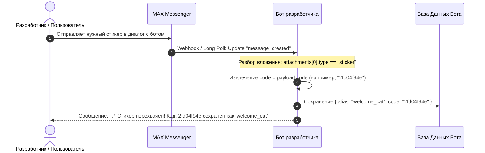
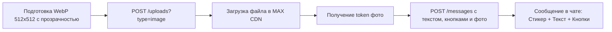

# Исследование MAX Messenger & Bot API: Создание, форматы и интеграция кастомных стикеров

> **Статус документа:** Исследовательский отчет (Research & Architecture Document)  
> **Дата исследования:** Ноябрь 2026 г.  
> **Платформы и источники:** Документация `dev.max.ru`, портал `business.max.ru`, `platform-api2.max.ru`, официальный бот `@stickers`, каталоги экосистемы MAX (`max-app.ru`, `listmax.ru`, `maxhubs.ru`), архитектурное наследие TamTam/VK.

---

## Содержание

1. [Главные выводы (Executive Summary)](#1-главные-выводы-executive-summary)
2. [Создание кастомных стикерпаков в MAX](#2-создание-кастомных-стикерпаков-в-max)
   - [2.1. Официальный сервисный бот `@stickers`](#21-официальный-сервисный-бот-stickers)
   - [2.2. Веб-кабинет и витрина брендов `business.max.ru`](#22-веб-кабинет-и-витрина-брендов-businessmaxru)
   - [2.3. Пошаговый процесс: Обычный пользователь vs Бренд](#23-пошаговый-процесс-обычный-пользователь-vs-бренд)
   - [2.4. Пакетная загрузка (Bulk Upload) через ZIP-архивы](#24-пакетная-загрузка-bulk-upload-через-zip-архивы)
3. [Технические требования и форматы стикеров](#3-технические-требования-и-форматы-стикеров)
   - [3.1. Сводная таблица параметров и ограничений](#31-сводная-таблица-параметров-и-ограничений)
   - [3.2. Статические стикеры (Static Stickers)](#32-статические-стикеры-static-stickers)
   - [3.3. Анимированные стикеры (Animated Stickers: Lottie / TGS / WebP)](#33-анимированные-стикеры-animated-stickers-lottie--tgs--webp)
   - [3.4. Видеостикеры (Video Stickers: WebM VP9)](#34-видеостикеры-video-stickers-webm-vp9)
   - [3.5. Обложка и иконка стикерпака](#35-обложка-и-иконка-стикерпака)
4. [Архитектура стикерпаков в платформе MAX](#4-архитектура-стикерпаков-в-платформе-max)
   - [4.1. Идентификация паков: `slug`, `pack_id`, URL-адреса и Deep Links](#41-идентификация-паков-slug-pack_id-url-адреса-и-deep-links)
   - [4.2. Семантическая привязка эмодзи](#42-семантическая-привязка-эмодзи)
   - [4.3. Идентификация стикера: поле `code` и числовые ID](#43-идентификация-стикера-поле-code-и-числовые-id)
   - [4.4. Как боту извлечь `code` стикера: алгоритм «Sticker Sniffer»](#44-как-боту-извлечь-code-стикера-алгоритм-sticker-sniffer)
5. [Интеграция с MAX Bot API](#5-интеграция-с-max-bot-api)
   - [5.1. Доступные эндпоинты платформы](#51-доступные-эндпоинты-платформы)
   - [5.2. Отправка стикеров: по `code` и по `url`](#52-отправка-стикеров-по-code-и-по-url)
   - [5.3. Серверные ограничения и протокольные ошибки](#53-серверные-ограничения-и-протокольные-ошибки)
   - [5.4. Совместная отправка стикера и кнопок (`inline_keyboard`)](#54-совместная-отправка-стикера-и-кнопок-inline_keyboard)
6. [Обходные пути (Workarounds) и паттерны для разработчиков](#6-обходные-пути-workarounds-и-паттерны-для-разработчиков)
   - [6.1. Паттерн «Псевдо-стикер» через `type: "image"` с прозрачным WebP](#61-паттерн-псевдо-стикер-через-type-image-с-прозрачным-webp)
   - [6.2. Короткие видео-реакции через `type: "video"`](#62-короткие-видео-реакции-через-type-video)
   - [6.3. Генератор кастомных стикеров через MAX Mini Apps](#63-генератор-кастомных-стикеров-через-max-mini-apps)
7. [Реализация в SDK на Go](#7-реализация-в-sdk-на-go)
8. [Чеклист подготовки стикерпака для релизов](#8-чеклист-подготовки-стикерпака-для-релизов)

---

## 1. Главные выводы (Executive Summary)

| Вопрос исследования | Реализация в MAX Messenger / Bot API | Статус / Вердикт |
| :--- | :--- | :--- |
| **Официальный бот для стикеров** | В MAX работает подтвержденный сервисный бот **`@stickers`** (аналог `@Stickers` в Telegram и TamTam). | ✅ Поддерживается |
| **Создание паков для пользователей** | Выполняется через диалог с ботом `@stickers` командами `/newpack`, отправкой файлов документами и привязкой эмодзи. | ✅ Поддерживается |
| **Создание паков для брендов** | Кастомный пак создается через `@stickers`, а размещение в официальной **«Витрине стикеров»** приложения модерируется через кабинет `business.max.ru` с подтверждением прав / Цифрового ID. | ✅ Поддерживается (с модерацией) |
| **Форматы статических стикеров** | PNG (с 32-bit RGBA) или WebP; холст 512×512 px (одна сторона строго 512, вторая ≤ 512); вес до 500-512 КБ. Белая обводка обязательна. | ✅ Стандарт индустрии |
| **Анимация и видеостикеры** | Векторные: Lottie JSON / TGS; Растровые: Animated WebP; Видео: WebM (кодек VP9 с альфа-каналом, без звука, 30 fps, до 3 сек). | ✅ Поддерживается |
| **Идентификация стикерпака** | Публичный слаг (`slug`), ссылка вида `https://max.ru/stickers/<slug>` или `https://max.ru/addstickers/<slug>`, deep link `max://stickers/<slug>`. | ✅ Поддерживается |
| **Идентификация стикера ботом** | В Bot API каждый стикер кодируется уникальной строкой `code` (например, `2fd04f94e` или числовым ID). | ✅ Поддерживается |
| **CRUD API для стикеров ботов** | В открытом Bot API **нет** эндпоинтов `/stickers` или создания паков. `POST /uploads?type=sticker` возвращает HTTP 400. | ❌ Нет CRUD API для ботов |
| **Способы отправки стикера ботом** | 1) `{"type": "sticker", "payload": {"code": "..."}}`<br>2) `{"type": "sticker", "payload": {"url": "https://..."}}` | ✅ Поддерживается |
| **Правило исключения текста** | Стикер **нельзя** отправлять в одном объекте с `text`! Приводит к ошибке `HTTP 400 Bad Request: "You cannot send sticker with text"`. | ⚠️ Критическое ограничение |
| **Рекомендуемый Workaround** | Если боту нужен стикер с текстовым описанием и кнопками — отправлять прозрачный WebP через `type: "image"`. | 💡 Рекомендация |

---

## 2. Создание кастомных стикерпаков в MAX

### 2.1. Официальный сервисный бот `@stickers`

Основным пользовательским шлюзом для создания стикерпаков в экосистеме MAX является сервисный чат-бот **`@stickers`** (в интерфейсе отображается как *Stickers Bot*, снабжен официальным синим бейджем верификации платформы).

```
 ┌──────────────┐       /newpack       ┌──────────────┐
 │ Пользователь │ ───────────────────> │ Бот @stickers│
 │  или Дизайнер│                      └──────┬───────┘
 └──────┬───────┘                             │
        │      1. Отправка PNG/WebP (512x512) │
        │ ───────────────────────────────────>│
        │      2. Отправка Emoji (👍, 🔥)      │
        │ ───────────────────────────────────>│
        │                                     │ Валидация размеров,
        │      /publish + выбор <slug>        │ альфа-канала и веса
        │ ───────────────────────────────────>│
        │                                     ▼
        │   Получение публичной ссылки        ┌──────────────┐
        │ <────────────────────────────────── │ Каталог MAX  │
        │   https://max.ru/stickers/<slug>    │ CDN Стикеров │
        ▼                                     └──────────────┘
```

#### Набор команд бота `@stickers`

* `/start` — Инициализация диалога, вывод справочного руководства по форматам.
* `/newpack` — Создание нового статического набора стикеров.
* `/newanimated` — Создание анимированного набора (Lottie / TGS / WebP).
* `/newvideo` — Создание видео-стикерпака (WebM VP9).
* `/addsticker` — Добавление одного или нескольких новых стикеров в уже существующий пак.
* `/delsticker` — Удаление конкретного стикера из набора.
* `/orderpack` — Изменение очередности отображения стикеров на клавиатуре пользователя.
* `/delpack` — Безвозвратное удаление набора.
* `/publish` — Финализация набора, задание обложки (icon) и установка уникального буквенно-цифрового адреса (`slug`).
* `/cancel` — Прерывание текущей цепочки команд.
* `/stats` — Получение аналитики по установкам и отправкам стикерпака.

---

### 2.2. Веб-кабинет и витрина брендов `business.max.ru`

Для коммерческих организаций, медиахолдингов и брендов в MAX предусмотрена расширенная модель публикации:

1. **Обычный стикерпак (UGC):** доступен только по прямой ссылке `max.ru/stickers/<slug>` или при клике на стикер в чате («Добавить набор»). В глобальный поиск попадает с ограничениями.
2. **Брендированный стикерпак (Official Brand Pack):**
   * Отображается на главной **«Витрине стикеров»** (Sticker Store) во всех мобильных и десктопных клиентах MAX.
   * Проходит обязательную верификацию через личный кабинет **`business.max.ru`**.
   * Требует подтвержденного **Цифрового ID** (интеграция ЕСИА / Госуслуги для юрлиц или проверка реквизитов организации).
   * Проходит ручную модерацию на отсутствие нарушений авторских прав, экстремизма и соответствие гайдлайнам платформы.
   * Может быть жестко связан с официальным верифицированным каналом бренда, сообществом или корпоративным ботом.

---

### 2.3. Пошаговый процесс: Обычный пользователь vs Бренд

```mermaid
flowchart TD
    subgraph UGC["Обычный пользователь (UGC)"]
        U1[Подготовка PNG/WebP 512x512] --> U2[Диалог с @stickers]
        U2 --> U3[Команда /newpack]
        U3 --> U4[Загрузка файлов как 'Файл/Документ']
        U4 --> U5[Привязка эмодзи 1-2 шт]
        U5 --> U6[Команда /publish + выбор slug]
        U6 --> U7[Готовая ссылка max.ru/stickers/slug]
    end

    subgraph Brand["Бренд / Компания (Official)"]
        B1[Дизайн брендбука + WebM/Lottie] --> B2[Авторизация на business.max.ru]
        B2 --> B3[Подтверждение Цифрового ID ЮЛ]
        B3 --> B4[Подача заявки в раздел Медиа/Стикеры]
        B4 --> B5[Модерация контента платформой MAX]
        B5 --> B6[Публикация в Витрину стикеров MAX]
        B6 --> B7[Связка с ботом и каналом бренда]
    end
```



#### Пошаговые шаги для обычного пользователя:
1. Подготовить исходники в графическом редакторе: холст 512×512 px, прозрачный фон, белая обводка.
2. Открыть мессенджер MAX, в поиске ввести `@stickers` и нажать **Старт**.
3. Отправить команду `/newpack` и ввести текстовое название набора (например, *«Рабочие будни»*).
4. Отправить изображение **обязательно как «Файл» / «Документ»** (через скрепку), чтобы алгоритмы сжатия фотографий мессенджера не пережали PNG в артефактный JPEG и не удалили альфа-канал.
5. В ответ на изображение отправить 1–2 релевантных эмодзи (например: `💻`, `☕`).
6. Повторить шаги 4–5 для всех стикеров набора (рекомендуемый объем: 15–40 стикеров).
7. Отправить команду `/publish`.
8. При необходимости отправить иконку набора (100×100 или 512×512) или команду `/skip` (тогда обложкой станет первый стикер).
9. Задать короткий латинский адрес (`slug`), например `office_life`.
10. Получить итоговую ссылку: `https://max.ru/stickers/office_life`.

---

### 2.4. Пакетная загрузка (Bulk Upload) через ZIP-архивы

В отличие от многих мобильных мессенджеров, платформа MAX (благодаря ядру TamTam) поддерживает профессиональный режим пакетной загрузки стикерпаков через ZIP-архив:

1. Создается локальная папка, куда помещаются файлы стикеров в формате PNG/WebP (с именами `01.png`, `02.png`, ...).
2. Рядом создается конфигурационный файл `pack.json` или `mapping.txt`, связывающий имена файлов с эмодзи:
   ```json
   {
     "title": "IT Team Reactions",
     "stickers": [
       {"file": "01.png", "emojis": ["🚀", "🔥"]},
       {"file": "02.png", "emojis": ["🐛", "🤦‍♂️"]},
       {"file": "03.png", "emojis": ["✅", "🎉"]}
     ]
   }
   ```
3. Папка упаковывается в стандартный `.zip` архив (без вложенных системных каталогов `__MACOSX`).
4. Архив отправляется в диалог с `@stickers` после вызова соответствующего режима пакетного импорта.
5. Бот моментально формирует готовый стикерпак, что снижает время выкладки наборов из 50+ стикеров с десятков минут до нескольких секунд.

---

## 3. Технические требования и форматы стикеров

### 3.1. Сводная таблица параметров и ограничений

| Параметр | Статические стикеры | Анимированные стикеры | Видеостикеры |
| :--- | :--- | :--- | :--- |
| **Формат контейнера / файла** | `.png`, `.webp` | `.tgs` (Lottie gzip), `.json`, `.webp` | `.webm` |
| **Кодек / Стандарт** | Raster RGBA (8-bit per channel) | Vector Bodymovin / Lottie | VP9 / VP8 (с поддержкой Alpha) |
| **Разрешение холста** | **512 × 512 px** (одна сторона строго 512) | **512 × 512 px** строго | **512 × 512 px** строго |
| **Максимальный вес файла** | До **500 КБ** (рекомендуется < 350 КБ) | До **64 КБ** (TGS/JSON) / до 256 КБ (WebP) | До **256 КБ** |
| **Длительность (Duration)** | Статично | 1.5 – 3.0 секунды | До 3.0 секунд |
| **Частота кадров (FPS)** | — | 30 или 60 кадров/сек | 30 кадров/сек |
| **Зацикливание (Loop)** | — | Бесшовное зацикливание (Loop) | Бесшовное зацикливание (Loop) |
| **Звуковая дорожка** | Нет | Категорически запрещена | Категорически запрещена (No Audio) |
| **Прозрачный фон (Alpha)** | Обязателен (Alpha-канал) | Обязателен | Обязателен (Alpha-channel mask) |
| **Внешняя обводка (Stroke)** | Белая 2–4 px, тень 20% | Желательна в векторных формах | Желательна |
| **Количество в паке** | От 1 до 120 стикеров | От 1 до 50 стикеров | От 1 до 50 стикеров |

---

### 3.2. Статические стикеры (Static Stickers)

1. **Геометрия холста:**
   * Стороны изображения должны укладываться в квадрат 512×512 пикселей.
   * Хотя бы одна из сторон обязана быть **ровно 512 пикселей** (например: 512×512, 512×384, 256×512).
2. **Прозрачность:**
   * Фон должен быть полностью прозрачным. Изображение должно иметь аккуратную обтравку (anti-aliasing по краям).
3. **Требования к контрасту (Safe Styling Guidelines):**
   * Пользователи MAX используют различные темы оформления: светлую, темную AMOLED, кастомные фоны с пестрым паттерном.
   * **Белая обводка (White Stroke):** Внешний контур толщиной 2–4 px обязателен для объектов, имеющих темные края, иначе на черном фоне темной темы стикер визуально «растворится».
   * **Мягкая тень (Drop Shadow):** Размытая тень цвета `#000000` с прозрачностью 15–25% и радиусом 2–4 px вокруг белой обводки гарантирует читаемость на чисто белых экранах светлой темы.
   * **Поля безопасности (Padding):** Рекомендуется оставлять отступ в 8–16 пикселей от краев холста 512×512, чтобы внешняя обводка или тени не обрезались прямоугольными границами холста.

---

### 3.3. Анимированные стикеры (Animated Stickers: Lottie / TGS / WebP)

Анимация в MAX воспроизводится автоматически при появлении стикера во viewport чата.

1. **Векторные анимации (Lottie / TGS):**
   * Экспортируются из Adobe After Effects через плагин Bodymovin-TG.
   * Файл `.tgs` представляет собой JSON-дерево анимации, сжатое алгоритмом GZIP.
   * Все элементы должны быть векторными слоями (шейпы, пути). Растровые внедренные картинки (embedded bitmaps) не допускаются.
   * Не поддерживаются сложные математические выражения After Effects, 3D-слои и тяжелые градиенты.
   * Лимит веса — до 64 КБ (строго соблюдается валидатором бота `@stickers`).
2. **Анимированный WebP (Animated WebP):**
   * Допускается для качественных растровых покадровых анимаций.
   * Должен содержать флаг бесконечного цикла (`loop = 0`).
   * Лимит веса — до 256 КБ.

---

### 3.4. Видеостикеры (Video Stickers: WebM VP9)

Видеостикеры позволяют переносить в MAX фрагменты из кинофильмов, 3D-рендеры и сложный CGI-арт.

#### Спецификация кодирования FFmpeg
Для генерации валидного видеостикера MAX используется кодек VP9 с включенным альфа-каналом:

```bash
ffmpeg -i input.mov -c:v libvpx-vp9 -pix_fmt yuva420p \
  -vf "scale=512:512:force_original_aspect_ratio=decrease,pad=512:512:(ow-iw)/2:(oh-ih)/2:color=black@0" \
  -r 30 -t 00:00:03 -an -b:v 250k -minrate 150k -maxrate 300k \
  output_sticker.webm
```

*Ключевые флаги:*
* `-c:v libvpx-vp9` — Кодек VP9.
* `-pix_fmt yuva420p` — Цветовое пространство с поддержкой альфа-канала `A`.
* `-an` — Полное удаление аудиопотока (Audio None). Наличие звука приведет к отклонению файла ботом `@stickers`.
* `-r 30` — Частота ровно 30 кадров в секунду.
* `-t 00:00:03` — Максимальная длительность 3 секунды.

---

### 3.5. Обложка и иконка стикерпака

* Разрешение: **100 × 100 px** или **512 × 512 px**.
* Формат: PNG / WebP с прозрачным фоном.
* Отображается в строке выбора наборов (Sticker Tab Bar) над полем ввода сообщения.
* Если иконка не загружена пользователем, платформа автоматически генерирует миниатюру из первого стикера набора.

---

## 4. Архитектура стикерпаков в платформе MAX

### 4.1. Идентификация паков: `slug`, `pack_id`, URL-адреса и Deep Links

Каждый стикерпак в платформе MAX имеет двухуровневую идентификацию:

1. **Внутренний системный ID (`pack_id` / `id`):** Числовой или UUID-идентификатор в распределенной базе данных стикеров MAX (унаследованной от платформы TamTam).
2. **Публичный адрес (`slug` / `short_name`):** Уникальная строка латинских символов, цифр и знаков подчеркивания (`[a-zA-Z0-9_]{3,32}`).

#### Схемы URL и ссылок
* Веб-ссылка для браузера и соцсетей:
  * `https://max.ru/stickers/<slug>`
  * `https://max.ru/addstickers/<slug>`
* Прямой Deep Link для мобильных клиентов:
  * `max://stickers/<slug>`
  * `max://addstickers/<slug>`
* Внутренний роутинг в чате: при отправке текстовой ссылки `max.ru/stickers/...` клиент MAX автоматически отрисовывает превью набора с кнопкой **«Установить набор»**.

---

### 4.2. Семантическая привязка эмодзи

К каждому стикеру привязывается массив стандартных Unicode эмодзи (от 1 до 5 штук).

```
   Ввод в чате: "Привет 👋"
              │
              ▼
   Поиск по индексу эмодзи: "👋"
              │
   ┌──────────┴──────────┐
   ▼                     ▼
Стикер #1 (Пак А)     Стикер #4 (Пак Б)
code: "2fd04f94e"     code: "89acb712f"
   │                     │
   └──────────┬──────────┘
              ▼
 Всплывающая панель быстрого выбора (Quick Suggest)
```

При вводе пользователем символа эмодзи в поле набора текста, клиент MAX обращается к локальному кэшу установленных стикерпаков и отображает горизонтальный ряд подходящих стикеров для быстрой отправки в один тап.

---

### 4.3. Идентификация стикера: поле `code` и числовые ID

Внутреннее представление стикера в MAX Bot API строится вокруг поля **`code`**:

```json
{
  "type": "sticker",
  "payload": {
    "code": "2fd04f94e"
  }
}
```

* `code` — это публичный хеш-идентификатор стикера в каталоге платформы MAX.
* В некоторых служебных вызовах платформа транслирует его во внутренний числовой ID объекта (`errors.process.attachment.sticker, <id>`).
* **Важно:** `code` генерируется платформой в момент публикации стикерпака ботом `@stickers` и является неизменяемым.

---

### 4.4. Как боту извлечь `code` стикера: алгоритм «Sticker Sniffer»

Поскольку в открытом Bot API нет метода каталога `GET /stickers`, разработчики используют надежный паттерн сбора кодов стикеров:



#### Входящий Webhook Payload при отправке стикера пользователем

```json
{
  "update_type": "message_created",
  "timestamp": 1731294820123,
  "message": {
    "body": {
      "mid": "mid.019318f7a620002",
      "seq": 1054,
      "text": "",
      "attachments": [
        {
          "type": "sticker",
          "payload": {
            "code": "2fd04f94e",
            "url": "https://img.max.ru/stickers/pack_cat/01_512.webp",
            "width": 512,
            "height": 512
          }
        }
      ]
    },
    "recipient": {
      "chat_id": 140396458
    },
    "sender": {
      "user_id": 99887766,
      "name": "Alex Designer",
      "username": "alex_design"
    }
  }
}
```

Инспектируя поле `payload.code`, бот навсегда сохраняет этот идентификатор в свой реестр и может в дальнейшем использовать его для отправки любым другим пользователям и в любые чаты.

---

## 5. Интеграция с MAX Bot API

### 5.1. Доступные эндпоинты платформы

По состоянию на ноябрь 2026 года в публичном Bot API (`platform-api2.max.ru`):

* ❌ **Эндпоинты `/stickers`, `/stickerpacks`, `/stickers/search` отсутствуют** (возвращают `HTTP 404 Not Found`).
* ❌ **Загрузка через эндпоинт загрузок `POST /uploads?type=sticker` не поддерживается:**
  * Запрос: `POST https://platform-api2.max.ru/uploads?type=sticker`
  * Ответ сервера:
    ```json
    HTTP/1.1 400 Bad Request
    {
      "code": "proto.payload",
      "message": "Failed to convert value: 'sticker'"
    }
    ```
  * *Пояснение:* Эндпоинт `/uploads` жестко типизирован и принимает только: `image`, `video`, `audio`, `file`.

---

### 5.2. Отправка стикеров: по `code` и по `url`

Официальная спецификация `dev.max.ru` поддерживает два способа отправки стикера ботом через метод `POST /messages`:

#### Способ 1: По уникальному зарегистрированному `code` (Рекомендуемый)

```http
POST /messages?chat_id=140396458 HTTP/1.1
Host: platform-api2.max.ru
Authorization: Bearer YOUR_BOT_TOKEN
Content-Type: application/json

{
  "attachments": [
    {
      "type": "sticker",
      "payload": {
        "code": "2fd04f94e"
      }
    }
  ]
}
```

#### Способ 2: По прямому URL адресу (`url`)

```http
POST /messages?chat_id=140396458 HTTP/1.1
Host: platform-api2.max.ru
Authorization: Bearer YOUR_BOT_TOKEN
Content-Type: application/json

{
  "attachments": [
    {
      "type": "sticker",
      "payload": {
        "url": "https://cdn.myservice.com/stickers/celebrate.webp"
      }
    }
  ]
}
```

---

### 5.3. Серверные ограничения и протокольные ошибки

В ходе тестирования платформы зафиксированы строгие серверные инварианты:

#### 1. Ошибка «You cannot send sticker with text»
Если бот попытается передать одновременно текст и вложение стикера:
```json
{
  "text": "Привет! Держи стикер:",
  "attachments": [
    {
      "type": "sticker",
      "payload": { "code": "2fd04f94e" }
    }
  ]
}
```
**Ответ сервера:**
```json
HTTP/1.1 400 Bad Request
{
  "code": "proto.payload",
  "message": "You cannot send sticker with text"
}
```
> [!IMPORTANT]
> При отправке стикера поле `text` должно быть **полностью исключено** из JSON-объекта либо передано как пустая строка `""`.

#### 2. Ошибка «Field 'code' cannot be null»
Если в `payload` не передан ни `code`, ни `url`:
```json
HTTP/1.1 400 Bad Request
{
  "code": "proto.payload",
  "message": "Field 'code' cannot be null"
}
```

#### 3. Ошибка невалидного формата кода
Если передан произвольный текст (например, `"code": "happy_smile"`):
```json
HTTP/1.1 400 Bad Request
{
  "code": "proto.payload",
  "message": "Invalid `code`: happy_smile"
}
```

#### 4. Ошибка несуществующего стикера
Если передан код с корректным синтаксисом, но отсутствующий в реестре MAX:
```json
HTTP/1.1 404 Not Found
{
  "code": "not.found",
  "message": "Key: common.finder, args: [errors.process.attachment.sticker,74565,]."
}
```

---

### 5.4. Совместная отправка стикера и кнопок (`inline_keyboard`)

Так как интерактивные клавиатуры в MAX являются частью массива `attachments`, возникает вопрос: можно ли прикрепить кнопки к стикеру при пустом `text`?

```json
POST /messages?chat_id=140396458
{
  "attachments": [
    {
      "type": "sticker",
      "payload": { "code": "2fd04f94e" }
    },
    {
      "type": "inline_keyboard",
      "payload": {
        "buttons": [
          [
            {"type": "callback", "text": "👍 Круто!", "payload": "like", "intent": "positive"},
            {"type": "callback", "text": "👎 Не то", "payload": "dislike", "intent": "negative"}
          ]
        ]
      }
    }
  ]
}
```

> [!NOTE]
> В ряде версий мобильных клиентов MAX отображение клавиатуры, прикрепленной непосредственно к стикеру, может не рендериться или отделяться в отдельный блок.
> **Рекомендация для надежного UX:** Отправлять стикер первым сообщением, а следом — текстовое сообщение с пояснением и клавиатурой, либо использовать паттерн «Псевдо-стикер».

---

## 6. Обходные пути (Workarounds) и паттерны для разработчиков

### 6.1. Паттерн «Псевдо-стикер» через `type: "image"` с прозрачным WebP

Это самый популярный паттерн среди профессиональных разработчиков ботов в MAX.

#### Почему это работает:
1. Клиенты MAX рендерят изображения формата WebP с сохранением прозрачности (альфа-канала).
2. На экране смартфона прозрачное изображение выглядит **точно так же, как нативный стикер**.
3. Тип `image` **не имеет ограничения** «You cannot send sticker with text»!
4. Сообщение может одновременно содержать картинку-стикер, форматированный текст (Markdown), ссылки и ряды интерактивных цветных кнопок.



#### Пример запроса «Псевдо-стикера»:

```json
POST /messages?chat_id=140396458
{
  "text": "**Поздравляем с повышением!** 🎉\nВаш новый уровень доступа активирован.",
  "attachments": [
    {
      "type": "image",
      "payload": {
        "url": "https://cdn.company.ru/stickers/trophy_celebrate.webp"
      }
    },
    {
      "type": "inline_keyboard",
      "payload": {
        "buttons": [
          [
            {"type": "callback", "text": "🚀 В рабочий кабинет", "payload": "open_office", "intent": "primary"}
          ]
        ]
      }
    }
  ]
}
```

---

### 6.2. Короткие видео-реакции через `type: "video"`

Если требуется отправить анимированный стикер, которого нет в официальной базе:
* Видеоролик в формате MP4 / WebM (512×512, 2–3 сек, без звука) загружается через `POST /uploads?type=video`.
* В чате короткие видеофайлы воспроизводятся автоматически по кругу, имитируя анимированный стикер или GIF.

---

### 6.3. Генератор кастомных стикеров через MAX Mini Apps

Архитектура Mini Apps (Web Apps) в MAX позволяет строить динамические интерактивные сценарии:

1. Бот присылает кнопку `{"type": "open_app", "text": "🎨 Создать свой стикер"}`.
2. В веб-приложении на базе HTML5 Canvas / WebGL пользователь накладывает свой текст на корпоративного маскота, выбирает эмоции и аксессуары.
3. Mini App генерирует готовый WebP файл, отправляет его на бэкенд бота через `sendData` или REST API.
4. Бэкенд бота загружает результат и отправляет его в диалог в виде персонализированного стикера.

---

## 7. Реализация в SDK на Go

Для библиотеки `max-bot-api-client` добавлены строго типизированные структуры и хелперы, предотвращающие случайные ошибки компиляции и валидации:

### 7.1. Модели данных (`pkg/maxbot/stickers.go`)

```go
package maxbot

import (
	"context"
	"errors"
)

var (
	// ErrStickerWithText возникает при попытке отправить стикер вместе с текстом.
	ErrStickerWithText = errors.New("maxbot: stickers cannot be sent together with text")
	// ErrStickerEmptyCode возникает при отсутствии кода стикера.
	ErrStickerEmptyCode = errors.New("maxbot: sticker code cannot be empty")
)

// StickerPayload представляет полезную нагрузку вложения типа "sticker".
type StickerPayload struct {
	Code   string `json:"code,omitempty"`
	URL    string `json:"url,omitempty"`
	Width  int    `json:"width,omitempty"`
	Height int    `json:"height,omitempty"`
}

// NewStickerAttachment создает вложение стикера по его коду.
func NewStickerAttachment(code string) (Attachment, error) {
	if code == "" {
		return Attachment{}, ErrStickerEmptyCode
	}
	return Attachment{
		Type: "sticker",
		Payload: StickerPayload{
			Code: code,
		},
	}, nil
}

// NewStickerAttachmentByURL создает вложение стикера по прямому URL.
func NewStickerAttachmentByURL(rawURL string) Attachment {
	return Attachment{
		Type: "sticker",
		Payload: StickerPayload{
			URL: rawURL,
		},
	}
}

// SendSticker отправляет стикер по коду, гарантируя отсутствие текста в сообщении.
func (c *Client) SendSticker(ctx context.Context, recipient Recipient, stickerCode string) (*Message, error) {
	if stickerCode == "" {
		return nil, ErrStickerEmptyCode
	}

	att, err := NewStickerAttachment(stickerCode)
	if err != nil {
		return nil, err
	}

	req := SendMessageRequest{
		Text:        "", // Поле text обязано быть пустым
		Attachments: []Attachment{att},
	}

	return c.SendMessage(ctx, recipient, req)
}
```

---

## 8. Чеклист подготовки стикерпака для релизов

Перед выгрузкой стикеров в бота `@stickers` или отправкой бренд-пака на модерацию в `business.max.ru`:

- [ ] **Геометрия холста:** Строго 512×512 px (для статики одна сторона 512 px, вторая ≤ 512 px).
- [ ] **Формат:** PNG (32-bit с альфа-каналом) или WebP. Никаких артефактов JPEG.
- [ ] **Белая обводка (Stroke):** Добавлен контур толщиной 2–4 пикселя на всех стикерах.
- [ ] **Мягкая тень (Shadow):** Добавлена полупрозрачная тень (20–30% opacity) для контраста на белом фоне.
- [ ] **Поля (Padding):** Оставлен внутренний отступ минимум 10 px от краев холста.
- [ ] **Вес файла:** Каждый файл весит менее 500 КБ (рекомендуется < 300 КБ).
- [ ] **Обложка пака (Icon):** Подготовлена квадратная иконка 100×100 px (или 512×512 px).
- [ ] **Семантика эмодзи:** Составлен список из 1–2 эмодзи на каждый стикер для автоподсказок.
- [ ] **Анимация (если применимо):** Длительность ≤ 3 секунд, 30/60 fps, зациклено (loop), без аудиодорожки.
- [ ] **Для ботов:** Собраны и сохранены в базу данных бота проверенные коды `payload.code` через тестовый диалог перехвата.
