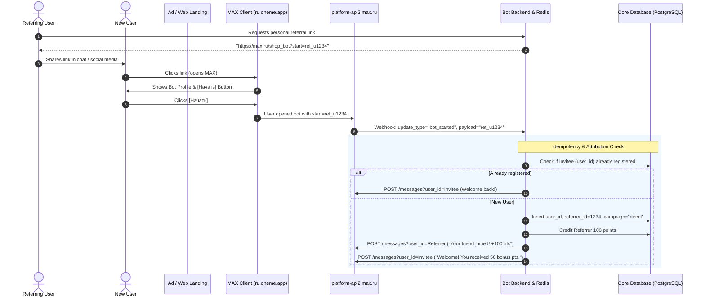
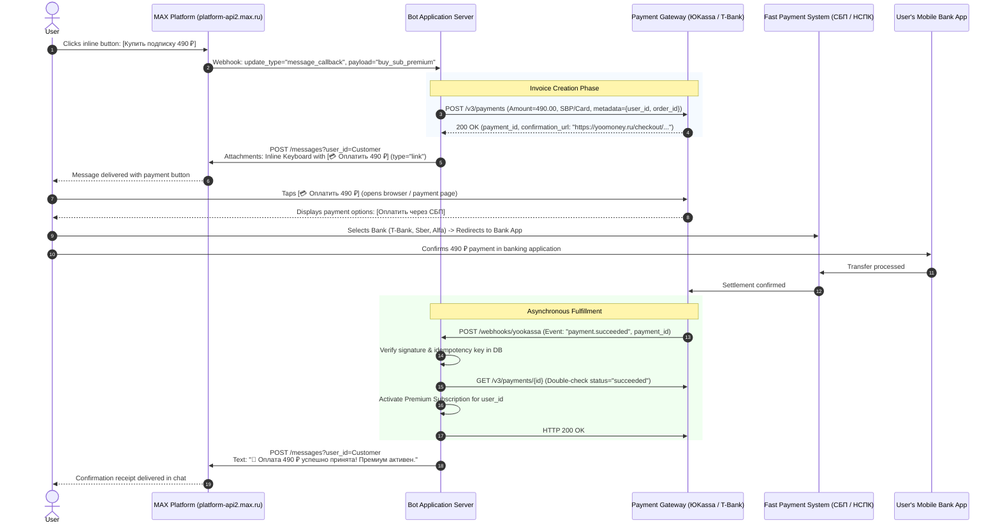

# MAX Messenger Bot Platform: Deep Linking, Payments & Mini-Apps Research Report

> **Date:** November 2026  
> **Target Platform:** MAX Messenger Bot API (`dev.max.ru` / `platform-api2.max.ru`)  
> **Output Path:** `docs/research/max-referrals-payments-miniapps.md`  
> **Status:** Production-Ready Research Reference  
> **Intended Audience:** System Architects, SDK Developers for `max-bot-api-client`, and Product Engineers  

---

## 1. Executive Summary

This report delivers an exhaustive technical investigation into three advanced capabilities of the **MAX Messenger Bot API** (`dev.max.ru`):
1. **Deep Linking & Referral Systems** (Traffic attribution, start parameters, event routing).
2. **Payment Integrations** (Native vs. external acquiring, SBP, fiscalization, webhook security).
3. **Mini-Apps / WebApps & WebViews** (In-app browser runtime, `open_app` button, `max-web-app.js` bridge, `initData` HMAC verification).

### Comparative Capability Matrix

| Capability Dimension | Telegram Bot API | VK Bot API | MAX Bot API (`dev.max.ru`) |
|---|---|---|---|
| **Bot Deep Link Format** | `https://t.me/<bot>?start=<payload>` | `https://vk.me/<club>?ref=<payload>` | `https://max.ru/<bot>?start=<payload>` |
| **Mobile App Scheme** | `tg://resolve?domain=<bot>&start=...` | `vk://vk.com/<club>?ref=...` | `max://max.ru/<bot>?start=...` |
| **Android Intent Package** | `org.telegram.messenger` | `com.vkontakte.android` | `ru.oneme.app` |
| **Start Payload Limit** | 64 chars (`[A-Za-z0-9_-]`) | 4096 chars (JSON payload) | **128 chars** (`[A-Za-z0-9_-]`) |
| **Start Event Type** | `message` (`/start <payload>`) | `message_allow` / `message_new` | `bot_started` update + `/start <payload>` |
| **Mini-App Launch Link** | `https://t.me/<bot>/<app>?startapp=...` | `https://vk.com/app<id>#<params>` | `https://max.ru/<bot>?startapp=<payload>` |
| **Mini-App Payload Limit** | 512 chars | Arbitrary URL hash | **512 chars** |
| **Native In-App Payments** | Telegram Stars (`XTR`), Native Stripe/YooKassa | VK Pay (`vkpay` button type) | **None** (External payment links only) |
| **Acquiring Gateway Pattern** | `sendInvoice` + `pre_checkout_query` | VK Pay Merchant API | `link` button -> External Gateway -> Webhook |
| **Embedded Mini-App Runtime**| Telegram Mini Apps (TMA) | VK Mini Apps (VKMA) | **MAX Mini Apps** (WebView) |
| **Mini-App Button Type** | `web_app` (`InlineKeyboardButton`) | `open_app` (`Button`) | `open_app` (`Button` with `webApp` field) |
| **JavaScript Bridge** | `telegram-web-app.js` (`window.Telegram.WebApp`)| `@vkontakte/vk-bridge` | `max-web-app.js` (`window.WebApp` / `window.MAX`)|
| **Launch Data Auth** | HMAC-SHA256(`"WebAppData"`, BotToken) | HMAC-SHA256 on query string | HMAC-SHA256(`"WebAppData"`, BotToken) |

---

## 2. Deep Linking, Referral Tracking & Traffic Attribution

### 2.1 Deep Link Schemes and Protocols

MAX Messenger supports cross-platform deep linking across desktop web browsers, iOS Safari/Universal Links, and Android Intents.

#### 1. Universal Web Link (Cross-Platform)
```text
https://max.ru/<bot_username>?start=<payload>
```
* **Behavior:**
  * When clicked on a desktop browser, redirects the user to the MAX Web client (`web.max.ru`) or prompts the user to download the desktop application.
  * When opened on a mobile device, OS Universal Links/App Links intercept the URL and hand it off directly to the native MAX client.

#### 2. Native App Scheme (`max://`)
```text
max://max.ru/<bot_username>?start=<payload>
```
* **Behavior:** Directly triggers the OS application protocol handler. If the app is installed, it opens instantly without an intermediate web browser tab. If the application is not installed, the browser displays a standard protocol error.

#### 3. Android Intent Link (Production Ad Campaigns)
For Russian performance marketing and mobile ad networks (Yandex Direct, VK Ads, Telegram channel ads), mobile browsers on Android can fail to trigger universal links reliably due to in-app browser sandbox restrictions. The canonical Android Intent structure for MAX is:

```text
intent://max.ru/<bot_username>?start=<payload>#Intent;scheme=max;package=ru.oneme.app;S.browser_fallback_url=https%3A%2F%2Fmax.ru%2F<bot_username>%3Fstart%3D<payload>;end
```
* **Parameters:**
  * `package=ru.oneme.app`: Targets the official MAX Android client package.
  * `scheme=max`: The internal URI scheme registered in `ru.oneme.app`'s `AndroidManifest.xml`.
  * `S.browser_fallback_url`: Gracefully directs the user to the web landing or download page if MAX is not installed.

---

### 2.2 Payload Specifications & Constraints

| Parameter | Specification / Constraint |
|---|---|
| **Query Key** | `?start=` (for bot entry) or `?startapp=` (for direct mini-app launch) |
| **Maximum Length** | **128 characters** for `?start=`; **512 characters** for `?startapp=` |
| **Permitted Character Set** | Alphanumeric characters (`a-z`, `A-Z`, `0-9`), underscores (`_`), and hyphens (`-`). URL encoding (`%20`, `%2F`) is rejected or stripped by the client parser. |
| **Payload Structure Convention** | Base64URL-encoded tokens, UUIDv4 without dashes, or delimited tokens: `<source>_<campaign>_<referrerId>` (e.g. `ref_u108429_vkads`). |

---

### 2.3 Event Lifecycle & Payload Extraction

When a user follows a deep link and opens a dialog with the bot, MAX dispatches update events to the bot's webhook or long-polling pipeline.

#### The `bot_started` Event
If the user interacts with the bot for the first time or presses the persistent **"Start"** («Начать») button:
```json
{
  "update_type": "bot_started",
  "timestamp": 1731238400000,
  "chat_id": 87654321,
  "user": {
    "user_id": 12345678,
    "first_name": "Ivan",
    "last_name": "Ivanov",
    "username": "i_ivanov",
    "is_bot": false
  },
  "payload": "ref_987654_vk"
}
```

#### Dual Delivery in `message_created`
In certain client versions (e.g., desktop web client or after conversation reset), the platform dispatches both a `bot_started` event and an initial synthetic command in `message_created`:
```json
{
  "update_type": "message_created",
  "message": {
    "message_id": "msg_01JB...",
    "sender": {
      "user_id": 12345678,
      "name": "Ivan Ivanov",
      "username": "i_ivanov"
    },
    "recipient": {
      "chat_id": null,
      "user_id": 12345678
    },
    "timestamp": 1731238400050,
    "body": {
      "text": "/start ref_987654_vk"
    }
  }
}
```

> [!IMPORTANT]
> **Deduplication Requirement:** Because a single entry can emit both `bot_started` with `payload` and `message_created` with `/start <payload>`, bot backends must execute traffic attribution idempotently. Storing `(user_id, "first_touch")` in Redis with `NX` ensures the referral bonus is granted exactly once.

---

### 2.4 Referral Funnel & Attribution Architecture



---

### 2.5 Go Implementation: Deep Link Generation & Attribution Handler

```go
package referral

import (
	"context"
	"crypto/subtle"
	"database/sql"
	"fmt"
	"net/http"
	"strings"
	"time"
)

// DeepLinkType defines the protocol target.
type DeepLinkType int

const (
	LinkUniversal DeepLinkType = iota
	LinkMaxScheme
	LinkAndroidIntent
)

// GenerateBotDeepLink constructs compliant deep links for MAX Messenger.
func GenerateBotDeepLink(botUsername, payload string, linkType DeepLinkType) (string, error) {
	if len(payload) > 128 {
		return "", fmt.Errorf("payload length %d exceeds maximum limit of 128 characters", len(payload))
	}
	cleanUsername := strings.TrimPrefix(botUsername, "@")

	switch linkType {
	case LinkUniversal:
		return fmt.Sprintf("https://max.ru/%s?start=%s", cleanUsername, payload), nil
	case LinkMaxScheme:
		return fmt.Sprintf("max://max.ru/%s?start=%s", cleanUsername, payload), nil
	case LinkAndroidIntent:
		return fmt.Sprintf(
			"intent://max.ru/%s?start=%s#Intent;scheme=max;package=ru.oneme.app;S.browser_fallback_url=https%%3A%%2F%%2Fmax.ru%%2F%s%%3Fstart%%3D%s;end",
			cleanUsername, payload, cleanUsername, payload,
		), nil
	default:
		return "", fmt.Errorf("unsupported link type")
	}
}

// BotStartedUpdate represents the inbound webhook update for bot launch.
type BotStartedUpdate struct {
	UpdateType string `json:"update_type"`
	Timestamp  int64  `json:"timestamp"`
	ChatID     int64  `json:"chat_id"`
	User       struct {
		UserID    int64  `json:"user_id"`
		FirstName string `json:"first_name"`
		Username  string `json:"username"`
	} `json:"user"`
	Payload string `json:"payload,omitempty"`
}

// AttributionService handles referral recording.
type AttributionService struct {
	db *sql.DB
}

// ProcessBotStarted extracts the start payload and awards referral bonuses idempotently.
func (s *AttributionService) ProcessBotStarted(ctx context.Context, u *BotStartedUpdate) error {
	if u.UpdateType != "bot_started" {
		return nil
	}

	payload := strings.TrimSpace(u.Payload)
	if payload == "" {
		return nil // Organic entry without referral
	}

	// Payload format convention: "ref_<referrerUserID>"
	if !strings.HasPrefix(payload, "ref_") {
		return nil // Non-referral campaign tag (e.g. ad source)
	}

	referrerIDStr := strings.TrimPrefix(payload, "ref_")
	var referrerID int64
	if _, err := fmt.Sscanf(referrerIDStr, "%d", &referrerID); err != nil {
		return fmt.Errorf("invalid referral payload format: %s", payload)
	}

	// Prevent self-referrals
	if referrerID == u.User.UserID {
		return nil
	}

	// Atomic registration in database
	query := `
		INSERT INTO bot_referrals (invitee_id, referrer_id, payload, created_at)
		VALUES ($1, $2, $3, $4)
		ON CONFLICT (invitee_id) DO NOTHING;
	`
	res, err := s.db.ExecContext(ctx, query, u.User.UserID, referrerID, payload, time.Now())
	if err != nil {
		return fmt.Errorf("failed to record referral: %w", err)
	}

	rowsAffected, _ := res.RowsAffected()
	if rowsAffected == 0 {
		// User was already registered earlier; attribution ignored
		return nil
	}

	// Award referral bonus logic...
	return nil
}
```

---

### 2.6 Workarounds for Referral Sharing in MAX

If a user wants to share their referral code with contacts inside MAX, the platform provides specialized inline keyboard buttons:

1. **Clipboard Copy Button (`clipboard`):**
   ```json
   {
     "type": "clipboard",
     "text": "📋 Скопировать реферальную ссылку",
     "data": "https://max.ru/my_shop_bot?start=ref_u12345"
   }
   ```
   * Clicking this copies the link into the user's mobile OS clipboard with an immediate haptic notification.
2. **Promo Code Fallback Entry:**
   Allow users to manually send a 6-character promo code in chat (e.g. `REF789`) if deep linking was blocked by external browsers.

---

## 3. Payment Integrations in MAX Messenger

### 3.1 Platform Assessment: Native In-App Payments

> [!IMPORTANT]
> **Schema Audit Finding:** As of late 2026, the official MAX Bot API (`platform-api2.max.ru` and the `max-messenger/api-schema` OpenAPI repository) **does not contain native payment endpoints** (there are no methods analogous to Telegram's `sendInvoice`, `pre_checkout_query`, `answerPreCheckoutQuery`, or VK Pay's `vkpay` inline button).

While the consumer MAX mobile client supports peer-to-peer (P2P) transfers via the Fast Payment System (СБП) between user phone numbers, automated commercial bots use **external acquiring gateways via inline `link` buttons**.

---

### 3.2 Commercial Payment Providers in the Russian Ecosystem

All high-traffic commercial bots on MAX (e.g., AI aggregators, food delivery, subscription services) implement external acquiring via Russian payment gateways:

| Provider | Supported Methods | Webhook Auth / Verification | Key Advantage |
|---|---|---|---|
| **ЮKassa (YooKassa)** | Mir, Visa/Mastercard (RF), SBP (СБП QR / Link), SberPay, T-Pay, Mir Pay | Basic Auth + Static IP Whitelist + SHA256 Checksum | Market leader, automatic recurrent subscriptions, built-in 54-FZ fiscalization |
| **T-Bank Acquiring (Tinkoff)** | Cards, SBP Dynamic QR, T-Pay, Installments (Долями) | Token signature generation: SHA256(Concatenated keys + Password) | Instant SBP settlement, lowest fees for T-Bank holders |
| **SberPay (Sberbank)** | Cards, SberPay, SBP | Client Secret / HMAC / mTLS Certificate | Largest retail banking base in Russia |
| **Prodamus** | Cards, SBP, CIS cards, Installments | Secret Key signature verification | Popular among info-businesses and self-employed |
| **CloudPayments** | Cards, SBP, Mir Pay | HMAC-SHA256 signature in `Content-HMAC` header | High-throughput recurring billing engine |
| **Robokassa** | Cards, SBP, E-wallets | MD5 / SHA256 signature verification | Flexible onboarding for individual entrepreneurs |

---

### 3.3 End-to-End Payment Flow via `link` Buttons



---

### 3.4 Production Go Implementation: Payment Order Creation & Webhook Ingress

Below is an enterprise-grade payment integration using **ЮKassa** and the MAX Bot API.

#### 1. Invoice Generator & Outbound Payment Message
```go
package payments

import (
	"bytes"
	"context"
	"encoding/json"
	"fmt"
	"net/http"
	"time"
)

// YooKassaClient handles payment session generation.
type YooKassaClient struct {
	ShopID    string
	SecretKey string
	Client    *http.Client
}

type CreatePaymentRequest struct {
	Amount struct {
		Value    string `json:"value"`
		Currency string `json:"currency"`
	} `json:"amount"`
	Confirmation struct {
		Type      string `json:"type"`
		ReturnURL string `json:"return_url"`
	} `json:"confirmation"`
	Capture     bool              `json:"capture"`
	Description string            `json:"description"`
	Metadata    map[string]string `json:"metadata"`
}

type CreatePaymentResponse struct {
	ID           string `json:"id"`
	Status       string `json:"status"`
	Paid         bool   `json:"paid"`
	Confirmation struct {
		ConfirmationURL string `json:"confirmation_url"`
	} `json:"confirmation"`
}

func (y *YooKassaClient) CreateInvoice(ctx context.Context, userID int64, orderID string, amountRUB float64, description string) (*CreatePaymentResponse, error) {
	reqBody := CreatePaymentRequest{
		Capture:     true,
		Description: description,
		Metadata: map[string]string{
			"max_user_id": fmt.Sprintf("%d", userID),
			"order_id":    orderID,
		},
	}
	reqBody.Amount.Value = fmt.Sprintf("%.2f", amountRUB)
	reqBody.Amount.Currency = "RUB"
	reqBody.Confirmation.Type = "redirect"
	reqBody.Confirmation.ReturnURL = fmt.Sprintf("https://max.ru/id%d", userID)

	data, _ := json.Marshal(reqBody)
	httpReq, err := http.NewRequestWithContext(ctx, http.MethodPost, "https://api.yookassa.ru/v3/payments", bytes.NewReader(data))
	if err != nil {
		return nil, err
	}

	httpReq.SetBasicAuth(y.ShopID, y.SecretKey)
	httpReq.Header.Set("Content-Type", "application/json")
	httpReq.Header.Set("Idempotence-Key", fmt.Sprintf("order-%s-%d", orderID, time.Now().Unix()))

	resp, err := y.Client.Do(httpReq)
	if err != nil {
		return nil, err
	}
	defer resp.Body.Close()

	if resp.StatusCode != http.StatusOK {
		return nil, fmt.Errorf("yookassa error status: %d", resp.StatusCode)
	}

	var paymentResp CreatePaymentResponse
	if err := json.NewDecoder(resp.Body).Decode(&paymentResp); err != nil {
		return nil, err
	}
	return &paymentResp, nil
}
```

#### 2. Constructing the MAX Payment Message with `link` Button
```go
package payments

// BuildPaymentMessage creates the JSON payload for POST https://platform-api2.max.ru/messages?user_id=...
func BuildPaymentMessage(confirmationURL string, amount float64, orderTitle string) map[string]any {
	return map[string]any{
		"text": fmt.Sprintf("💳 **Счёт на оплату заказа**\n\n**Товар:** %s\n**Сумма к оплате:** `%.2f ₽`\n\nНажмите кнопку ниже для перехода к безопасной оплате картой или через **СБП**:", orderTitle, amount),
		"format": "markdown",
		"attachments": []any{
			map[string]any{
				"type": "inline_keyboard",
				"payload": map[string]any{
					"buttons": [][]map[string]any{
						{
							{
								"type": "link",
								"text": fmt.Sprintf("💳 Оплатить %.2f ₽ (СБП / Карта)", amount),
								"url":  confirmationURL,
							},
						},
						{
							{
								"type":    "callback",
								"text":    "❌ Отменить заказ",
								"payload": "cancel_order",
							},
						},
					},
				},
			},
		},
	}
}
```

#### 3. Inbound Payment Webhook Ingress & Verification
```go
package payments

import (
	"crypto/subtle"
	"encoding/json"
	"io"
	"net/http"
	"strconv"
)

type YooKassaWebhookPayload struct {
	Type   string `json:"type"`
	Event  string `json:"event"`
	Object struct {
		ID       string `json:"id"`
		Status   string `json:"status"`
		Paid     bool   `json:"paid"`
		Amount   struct {
			Value    string `json:"value"`
			Currency string `json:"currency"`
		} `json:"amount"`
		Metadata struct {
			MaxUserID string `json:"max_user_id"`
			OrderID   string `json:"order_id"`
		} `json:"metadata"`
	} `json:"object"`
}

type PaymentNotifier interface {
	NotifyUserPaymentSuccess(ctx context.Context, userID int64, orderID string, amount string) error
}

func YooKassaWebhookHandler(notifier PaymentNotifier, expectedSecret string) http.HandlerFunc {
	return func(w http.ResponseWriter, r *http.Request) {
		if r.Method != http.MethodPost {
			http.Error(w, "Method Not Allowed", http.StatusMethodNotAllowed)
			return
		}

		// Verify optional secret token header or basic auth
		authSecret := r.Header.Get("X-Payment-Webhook-Secret")
		if expectedSecret != "" && subtle.ConstantTimeCompare([]byte(authSecret), []byte(expectedSecret)) != 1 {
			http.Error(w, "Unauthorized", http.StatusUnauthorized)
			return
		}

		body, err := io.ReadAll(r.Body)
		if err != nil {
			http.Error(w, "Cannot read body", http.StatusBadRequest)
			return
		}

		var event YooKassaWebhookPayload
		if err := json.Unmarshal(body, &event); err != nil {
			http.Error(w, "Invalid JSON", http.StatusBadRequest)
			return
		}

		// Acknowledge receipt to gateway immediately
		w.WriteHeader(http.StatusOK)

		// Process success event asynchronously
		if event.Event == "payment.succeeded" && event.Object.Status == "succeeded" {
			userID, _ := strconv.ParseInt(event.Object.Metadata.MaxUserID, 10, 64)
			orderID := event.Object.Metadata.OrderID
			amount := event.Object.Amount.Value

			// Execute DB state change & send delivery message to user via MAX API
			go notifier.NotifyUserPaymentSuccess(context.Background(), userID, orderID, amount)
		}
	}
}
```

---

### 3.5 Security & Fiscalization (54-FZ)

1. **Idempotency Safeguards:**  
   Payment gateways guarantee *at-least-once* delivery. Webhook handlers must store the unique `payment.object.id` in a database with a unique index. Duplicate events must return `HTTP 200 OK` immediately without repeating fulfillment.
2. **Double Verification (Pull-Check):**  
   Never fulfill high-value digital orders based solely on the incoming webhook payload. Before granting access, the bot backend should make a direct GET request to `https://api.yookassa.ru/v3/payments/{id}` to verify that `status == "succeeded"` and `amount.value` matches the order total.
3. **Russian Fiscal Law (54-ФЗ):**  
   Commercial sales to Russian individuals require electronic fiscal receipts (чеки). Both YooKassa and Robokassa provide automated cloud cash-register integrations (Атол Онлайн, Оранжевый Плющ, МойСклад) where the bot passes the `receipt` object containing the customer's phone/email and VAT items.

---

## 4. Mini-Apps, WebApps & Embedded WebViews

### 4.1 Native Mini-App Architecture in MAX

MAX Messenger includes a full embedded WebView runtime capable of executing single-page web applications (Mini Apps).

#### Key Differences: Telegram vs. VK vs. MAX Mini Apps
* **Telegram Mini Apps (TMA):** Runs within an embedded Chromium/WebKit WebView; initializes via `window.Telegram.WebApp`.
* **VK Mini Apps (VKMA):** Built on the VK Bridge protocol (`@vkontakte/vk-bridge`), heavily coupled to VKUI styles and VK OAuth tokens.
* **MAX Mini Apps:** Architectural hybrid engineered under VK. To simplify developer migration from Telegram, MAX uses a Telegram-compatible JS bridge pattern:
  * **Bridge Script:** `https://st.max.ru/js/max-web-app.js`
  * **Global Context:** Exposed as `window.WebApp` and `window.MAX`.
  * **Initialization Data:** `window.WebApp.initData` and `window.WebApp.initDataUnsafe`.

---

### 4.2 Inline Keyboard Integration: The `open_app` Button

The MAX Bot API defines a specialized button type in `inline_keyboard` attachments dedicated to launching Mini Apps: **`open_app`**.

#### Button Specification in OpenAPI Schema
```json
{
  "type": "open_app",
  "text": "Открыть каталог",
  "webApp": "https://mini-app.example.com/store",
  "contactId": 0
}
```

#### Constraint Matrix:
* **Required Fields:** `type` (must be `"open_app"`), `text` (string), and `webApp` (target HTTPS URL string).
* **Null Validation:** If `webApp` is omitted or set to `null`, `platform-api2.max.ru` rejects the message with `400 Bad Request` (`"Field 'webApp' cannot be null"`).
* **Row Density Limit:** When a row contains buttons of type `open_app`, `link`, `request_geo_location`, or `request_contact`, the row is restricted to a **maximum of 3 buttons** (standard `callback` buttons allow up to 7 buttons per row).

---

### 4.3 JavaScript Bridge: `max-web-app.js`

To enable the web application to communicate with the native MAX client shell, developers include the official bridge script in their HTML header:

```html
<!DOCTYPE html>
<html lang="ru">
<head>
  <meta charset="UTF-8">
  <meta name="viewport" content="width=device-width, initial-scale=1.0, user-scalable=no">
  <title>MAX Mini App</title>
  <!-- Official MAX Messenger WebApp Bridge -->
  <script src="https://st.max.ru/js/max-web-app.js"></script>
</head>
<body>
  <div id="app"></div>

  <script>
    // Initialize bridge
    const app = window.WebApp || window.MAX;

    if (app) {
      app.ready();
      app.expand(); // Expand WebView to full height

      // Read initialization context
      console.log("Current User:", app.initDataUnsafe.user);
      console.log("Start Parameter:", app.initDataUnsafe.start_param);

      // Handle main button
      app.MainButton.setText("Оформить заказ (1 200 ₽)");
      app.MainButton.show();
      app.MainButton.onClick(() => {
        app.sendData(JSON.stringify({ action: "checkout", cart_id: "cart_991" }));
      });
    }
  </script>
</body>
</html>
```

#### Bridge Methods & Attributes Supported

| Member | Type | Description |
|---|---|---|
| `app.ready()` | Method | Signals the client that the DOM is ready; dismisses loading spinner |
| `app.expand()` | Method | Expands the modal sheet to occupy full screen height |
| `app.close()` | Method | Closes the WebView modal and returns the user to the chat |
| `app.initData` | String | Raw URL-encoded cryptographic launch query string |
| `app.initDataUnsafe` | Object | Deserialized launch parameters (`user`, `chat`, `start_param`, `hash`) |
| `app.MainButton` | Object | Native bottom bar action button (`setText`, `show`, `hide`, `onClick`) |
| `app.BackButton` | Object | Native top navigation back button (`show`, `hide`, `onClick`) |
| `app.sendData(data)` | Method | Sends string data back to the bot and terminates the Mini App session |

---

### 4.4 Cryptographic Authentication: Validating `initData` in Go

To ensure that requests sent from the Mini App to your API originate from genuine MAX users and have not been tampered with by man-in-the-middle attackers, the server must validate `initData`.

#### Algorithm:
1. Parse the URL query string from `initData`.
2. Extract the `hash` parameter.
3. Sort all remaining key-value pairs alphabetically by key.
4. Join them into a data-check string delimited by `\n` (`"auth_date=...\nquery_id=...\nuser=..."`).
5. Compute a secret key: `secret_key = HMAC_SHA256("WebAppData", bot_token)`.
6. Compute the signature: `expected_hash = Hex(HMAC_SHA256(secret_key, data_check_string))`.
7. Compare `expected_hash` with `hash` using constant-time comparison.

```go
package miniapp

import (
	"crypto/hmac"
	"crypto/sha256"
	"crypto/subtle"
	"encoding/hex"
	"encoding/json"
	"errors"
	"fmt"
	"net/url"
	"sort"
	"strconv"
	"strings"
	"time"
)

type UserData struct {
	ID        int64  `json:"id"`
	FirstName string `json:"first_name"`
	LastName  string `json:"last_name,omitempty"`
	Username  string `json:"username,omitempty"`
}

type ValidatedInitData struct {
	User       UserData
	AuthDate   time.Time
	QueryID    string
	StartParam string
}

// ValidateInitData verifies that initData was signed by the authentic MAX platform token.
func ValidateInitData(rawInitData, botToken string, maxAge time.Duration) (*ValidatedInitData, error) {
	values, err := url.ParseQuery(rawInitData)
	if err != nil {
		return nil, fmt.Errorf("failed to parse initData query: %w", err)
	}

	receivedHash := values.Get("hash")
	if receivedHash == "" {
		return nil, errors.New("missing hash in initData")
	}

	// 1. Sort all keys alphabetically except 'hash'
	var keys []string
	for k := range values {
		if k != "hash" {
			keys = append(keys, k)
		}
	}
	sort.Strings(keys)

	// 2. Build data_check_string
	var parts []string
	for _, k := range keys {
		parts = append(parts, fmt.Sprintf("%s=%s", k, values.Get(k)))
	}
	dataCheckString := strings.Join(parts, "\n")

	// 3. Compute secret key: HMAC-SHA256("WebAppData", botToken)
	mac := hmac.New(sha256.New, []byte("WebAppData"))
	mac.Write([]byte(botToken))
	secretKey := mac.Sum(nil)

	// 4. Compute expected hash: HMAC-SHA256(secretKey, dataCheckString)
	h := hmac.New(sha256.New, secretKey)
	h.Write([]byte(dataCheckString))
	expectedHash := hex.EncodeToString(h.Sum(nil))

	// 5. Constant-time comparison
	if subtle.ConstantTimeCompare([]byte(expectedHash), []byte(receivedHash)) != 1 {
		return nil, errors.New("cryptographic signature mismatch: invalid initData")
	}

	// 6. Check replay freshness
	authDateInt, err := strconv.ParseInt(values.Get("auth_date"), 10, 64)
	if err != nil {
		return nil, errors.New("invalid or missing auth_date")
	}
	authTime := time.Unix(authDateInt, 0)
	if maxAge > 0 && time.Since(authTime) > maxAge {
		return nil, fmt.Errorf("initData expired (age: %v)", time.Since(authTime))
	}

	// 7. Parse user object
	var user UserData
	if userJSON := values.Get("user"); userJSON != "" {
		if err := json.Unmarshal([]byte(userJSON), &user); err != nil {
			return nil, fmt.Errorf("failed to decode user payload: %w", err)
		}
	}

	return &ValidatedInitData{
		User:       user,
		AuthDate:   authTime,
		QueryID:    values.Get("query_id"),
		StartParam: values.Get("start_param"),
	}, nil
}
```

---

### 4.5 Practical Workarounds for Rich UI

For bots that require rich interactive experiences without a full Mini App or for platforms where WebViews are restricted:

#### 1. Authenticated PWA via External `link` Buttons
Send a `link` button containing a single-use JWT with a 5-minute lifespan:
```text
https://shop.example.com/login?token=eyJhbGciOi...
```
When clicked, the user's mobile browser opens the responsive web app, automatically authenticates them, and remembers their session via local storage.

#### 2. Multi-Step Inline Form Simulation
Using `callback` buttons and atomic message edits via `POST /answers?callback_id=...`:
* Step 1: Category selection (`[🍕 Pizza] [🍣 Sushi] [🥤 Drinks]`).
* Step 2: Item quantity adjustment (`[-] 2 [+]`).
* Step 3: Courier address confirmation via native buttons (`request_geo_location` and `request_contact`).
* Step 4: Final order summary with instant `link` button for payment.

---

## 5. Architectural Recommendations for `max-bot-api-client`

To empower Go developers to build commercial, high-conversion bots on MAX, the `max-bot-api-client` repository should implement the following abstractions:

### 1. Fluent Keyboard Builder with `OpenApp` & `Link` Support
```go
keyboard := maxbot.NewInlineKeyboard().
    Row(
        maxbot.NewOpenAppButton("🛍 Открыть магазин", "https://miniapp.shop.ru/catalog"),
    ).
    Row(
        maxbot.NewLinkButton("💳 Оплатить через СБП", paymentURL),
        maxbot.NewClipboardButton("📋 Реферальная ссылка", refLink),
    ).
    Row(
        maxbot.NewContactButton("📱 Поделиться телефоном"),
        maxbot.NewLocationButton("📍 Отправить координаты"),
    )
```

### 2. Deep Link Helper
```go
// Direct helper for building deep links with auto-escaping and validation
link, err := maxbot.BuildDeepLink(botUsername, payload, maxbot.DeepLinkUniversal)
```

### 3. Built-in `initData` Validator Middleware
A standard HTTP middleware for Go web frameworks (`net/http`, `gin`, `chi`, `fiber`) that inspects `Authorization: WebAppData <initData>` and injects the verified `UserData` into the request context.

---

## 6. Primary Sources & Citations

1. **Official MAX Developer Portal & Documentation:**
   * Developer Documentation: [https://dev.max.ru/docs/](https://dev.max.ru/docs/)
   * Chatbots Preparation & Bot API: [https://dev.max.ru/docs/chatbots/bots-coding/prepare](https://dev.max.ru/docs/chatbots/bots-coding/prepare)
   * API Methods & Webhook Specification: [https://dev.max.ru/docs-api](https://dev.max.ru/docs-api)
   * MAX for Business: [https://business.max.ru/](https://business.max.ru/)
2. **Official GitHub Repositories & Schemas:**
   * OpenAPI Specification: [`max-messenger/api-schema`](https://github.com/max-messenger/api-schema)
   * Official Go SDK: [`max-messenger/max-bot-api-client-go`](https://github.com/max-messenger/max-bot-api-client-go)
   * Official TypeScript SDK: [`max-messenger/max-bot-api-client-ts`](https://github.com/max-messenger/max-bot-api-client-ts)
   * Official WebApp Bridge Script: `https://st.max.ru/js/max-web-app.js`
3. **Community Libraries & Implementation References:**
   * TypeScript Framework `max-io`: [`xTCry/max-io`](https://github.com/xTCry/max-io)
   * Community Schema Mirror: [`xTCry/max-dev-openapi-schema`](https://github.com/xTCry/max-dev-openapi-schema)
   * Python Framework `aiomax`: [`dpnspn/aiomax`](https://github.com/dpnspn/aiomax)
   * .NET Bot Client: [`Max.BotClient`](https://www.nuget.org/packages/Max.BotClient)
4. **Engineering Case Studies & Primary Postmortems (Habr & VC.ru):**
   * *«Как мы подключили ИИ-бота к MAX: Bot API, общий мост с Telegram и диплинки»* ([Habr](https://habr.com))
   * *«Как мы за 54 дня собрали ИИ-хаб в мессенджере MAX» (Монетизация через ЮКассу)* ([Habr](https://habr.com))
   * *«MAX: технический разбор Android-приложения ru.oneme.app»* ([Habr](https://habr.com))
   * *«Переносим бота из Telegram в MAX: что отличается в API»* ([Habr](https://habr.com))
5. **Russian Payment Systems & Standards:**
   * Bank of Russia Fast Payment System (СБП): [https://sbp.nspk.ru/](https://sbp.nspk.ru/)
   * ЮKassa API Documentation: [https://yookassa.ru/developers/api](https://yookassa.ru/developers/api)
   * T-Bank (Tinkoff) Acquiring API: [https://developer.tbank.ru/docs/api/merchant](https://developer.tbank.ru/docs/api/merchant)
   * Federal Law No. 54-FZ on Cash Register Equipment: [http://www.consultant.ru/document/cons_doc_LAW_42359/](http://www.consultant.ru/document/cons_doc_LAW_42359/)
