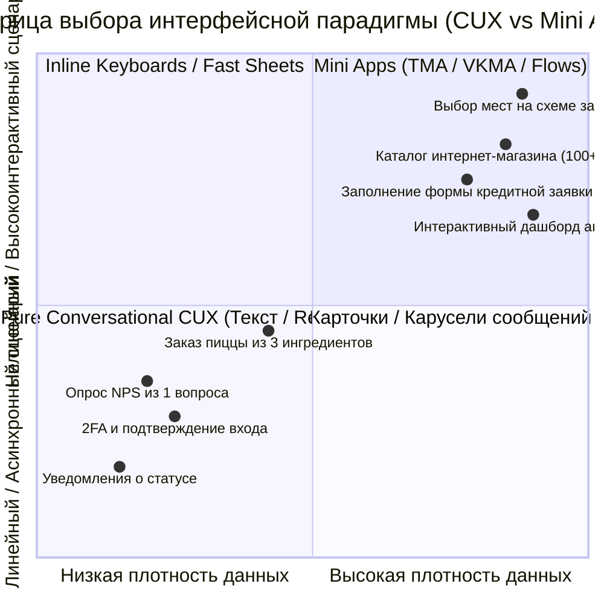
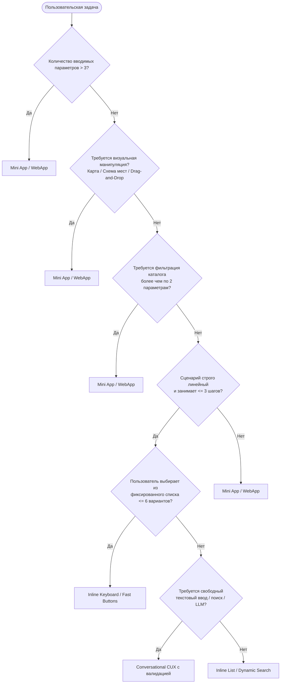
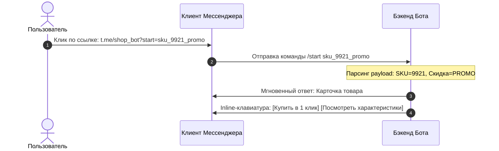
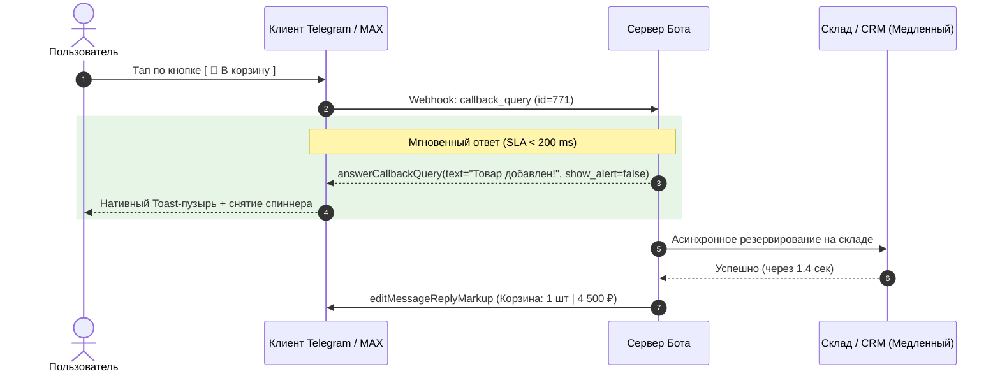
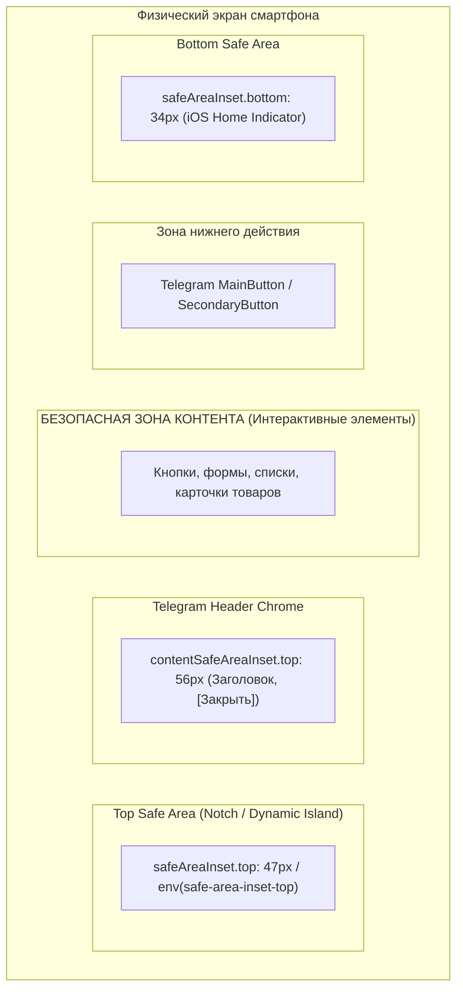
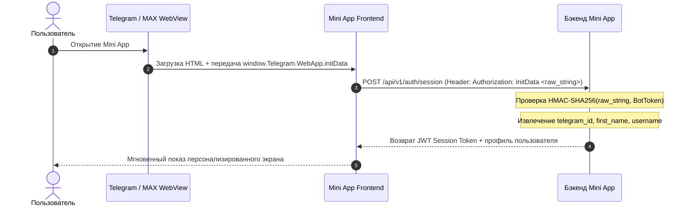
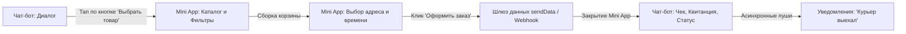

# UI/UX Best Practices for Chatbots and Mini Apps: Архитектура Conversational UX и кроссплатформенных микроприложений

> **Статус документа:** Production-Ready Research Reference  
> **Целевые платформы:** Telegram, VK, MAX Messenger (`dev.max.ru`), WhatsApp Cloud API  
> **Дизайн-стандарты:** Apple Human Interface Guidelines (HIG), Google Material Design 3 (M3), Nielsen Norman Group (NN/g) CUX Research  
> **Целевая аудитория:** Principal Product Designers, Conversational UX (CUX) Architects, Lead Frontend Engineers, SDK Developers (`max-bot-api-client`)  
> **Выходной артефакт:** `docs/research/ui-ux-chatbots-and-miniapps-best-practices.md`  

---

## Содержание

1. [Executive Summary и концептуальная модель](#1-executive-summary-и-концептуальная-модель)
   - [1.1. Conversational UI (CUX) vs Graphical UI (Mini Apps): Матрица разграничения](#11-conversational-ui-cux-vs-graphical-ui-mini-apps-матрица-разграничения)
   - [1.2. Дерево принятия решений (Decision Tree Architecture)](#12-дерево-принятия-решений-decision-tree-architecture)
   - [1.3. Эргономический фундамент: Закон Фиттса и Thumb Zone](#13-эргономический-фундамент-закон-фиттса-и-thumb-zone)
2. [Chatbot Conversational UX (CUX) Best Practices](#2-chatbot-conversational-ux-cux-best-practices)
   - [2.1. First-Touch Onboarding и точка входа](#21-first-touch-onboarding-и-точка-входа)
   - [2.2. Анатомия сообщения и информационная архитектура](#22-анатомия-сообщения-и-информационная-архитектура)
   - [2.3. Интерактивные элементы управления и эргономика клавиатур](#23-интерактивные-элементы-управления-и-эргономика-клавиатур)
   - [2.4. Паттерн In-Place Mutation vs Chat Flooding](#24-паттерн-in-place-mutation-vs-chat-flooding)
   - [2.5. Устранение Ghost Clicks и управление конкурентным состоянием](#25-устранение-ghost-clicks-и-управление-конкурентным-состоянием)
   - [2.6. Мгновенная тактильная и визуальная обратная связь](#26-мгновенная-тактильная-и-визуальная-обратная-связь)
   - [2.7. Управление задержками и восприятием времени (Latency Management)](#27-управление-задержками-и-восприятием-времени-latency-management)
   - [2.8. Обработка ошибок, деградация и спасательные круги (Escape Hatches)](#28-обработка-ошибок-деградация-и-спасательные-круги-escape-hatches)
3. [Mini Apps UI/UX Best Practices](#3-mini-apps-uiux-best-practices)
   - [3.1. Бесшовная нативная интеграция («Иллюзия нативного приложения»)](#31-бесшовная-нативная-интеграция-иллюзия-нативного-приложения)
   - [3.2. Стабильность вьюпорта и подавление паразитных браузерных жестов](#32-стабильность-вьюпорта-и-подавление-паразитных-браузерных-жестов)
   - [3.3. Safe Area Insets и аппаратные вырезы (Notch, Dynamic Island)](#33-safe-area-insets-и-аппаратные-вырезы-notch-dynamic-island)
   - [3.4. Навигация и нативный хром платформы](#34-навигация-и-нативный-хром-платформы)
   - [3.5. Эргономика действий: Native MainButton и SecondaryButton](#35-эргономика-действий-native-mainbutton-и-secondarybutton)
   - [3.6. Динамическая адаптация темы и визуальная гармония](#36-динамическая-адаптация-темы-и-визуальная-гармония)
   - [3.7. Семантическая тактильная отдача (Haptic Feedback)](#37-семантическая-тактильная-отдача-haptic-feedback)
   - [3.8. Аутентификация с нулевым трением и сохранение состояния](#38-аутентификация-с-нулевым-трением-и-сохранение-состояния)
   - [3.9. Производительность в сетях с низкой пропускной способностью](#39-производительность-в-сетях-с-низкой-пропускной-способностью)
4. [Гибридная синергия: Бесшовные сценарии Bot ↔ Mini App](#4-гибридная-синергия-бесшовные-сценарии-bot--mini-app)
   - [4.1. Векторы запуска и сквозная передача контекста](#41-векторы-запуска-и-сквозная-передача-контекста)
   - [4.2. Механизмы возврата данных и закрытия шлюза (`sendData` vs Webhook Sync)](#42-механизмы-возврата-данных-и-закрытия-шлюза-senddata-vs-webhook-sync)
   - [4.3. Оформление заказов и нативный финишинг в диалоге](#43-оформление-заказов-и-нативный-финишинг-в-диалоге)
5. [Сравнительная матрица платформ](#5-сравнительная-матрица-платформ)
   - [5.1. Кроссплатформенная матрица UI/UX возможностей](#51-кроссплатформенная-матрица-uiux-возможностей)
   - [5.2. Специфика MAX Messenger (`dev.max.ru`) и адаптация паттернов](#52-специфика-max-messenger-devmaxru-и-адаптация-паттернов)
6. [Каталог практических рекомендаций и антипаттернов](#6-каталог-практических-рекомендаций-и-антипаттернов)
   - [6.1. Сводный чек-лист Do's and Don'ts](#61-сводный-чек-лист-dos-and-donts)
   - [6.2. Разбор антипаттернов с ASCII-вайрфреймами](#62-разбор-антипаттернов-с-ascii-вайрфреймами)
7. [Библиография и первичные источники](#7-библиография-и-первичные-источники)

---

## 1. Executive Summary и концептуальная модель

В мобильных экосистемах 2026 года диалоговый интерфейс (Conversational UI) и встроенные веб-приложения (Mini Apps / WebApps / Flows) перестали быть конкурирующими парадигмами. Они образуют **бимодальный пользовательский опыт (Bimodal UX)**.

Мессенджер выступает в роли сверхлегкой операционной системы. Пользователь перемещается между текстовым диалогом с асинхронным откликом и синхронным графическим микроприложением без смены контекста и без установки дополнительного ПО.

### 1.1. Conversational UI (CUX) vs Graphical UI (Mini Apps): Матрица разграничения

Главная ошибка проектирования — попытка решить любую задачу исключительно текстом чат-бота (порождая «разговорный ад» из 15 шагов) либо упаковать примитивную одноразовую команду в тяжелый Mini App.



#### Матрица когнитивной нагрузки и состояний

| Параметр оценки | Чат-бот (CUX / Inline Keyboard) | Графический Mini App (Web / Flows) |
| :--- | :--- | :--- |
| **Когнитивная нагрузка** | Минимальная при 1–3 шагах; экспоненциально растет при ветвлении | Постоянная, структурированная визуальной иерархией |
| **Пространственная координация** | Отсутствует (строго вертикальный поток сообщений) | Высокая (сетки, интерактивные карты, схемы залов, матрицы фильтров) |
| **Плотность ввода данных** | 1–2 дискретных параметра за шаг | Мульти-ввод (формы с 5+ взаимозависимыми полями, календари, слайдеры) |
| **Сложность фильтрации** | Линейные кнопки (максимум 6–8 категорий) | Фасетные фильтры, мультивыбор, динамическая сортировка без задержек |
| **Асинхронность** | Идеальна (бот может ответить через минуту, час, день) | Сессионная (требует непрерывного присутствия пользователя) |
| **Сетевые накладные расходы** | Минимальные (~1–2 КБ JSON на событие) | Загрузка бандла (оптимально < 150 КБ Brotli), рендеринг DOM |
| **Время входа в задачу (Time-to-Task)** | < 1 секунды (1 тап по кнопке) | 1.5–3 секунды (инициализация WebView, валидация `initData`) |

---

### 1.2. Дерево принятия решений (Decision Tree Architecture)

Инженерная модель выбора между диалоговым контролом и Mini App:



---

### 1.3. Эргономический фундамент: Закон Фиттса и Thumb Zone

При проектировании интерфейсов в мобильных мессенджерах ключевым фактором конверсии является анатомическая доступность элементов управления для большого пальца руки.

По классическим исследованиям Стивена Хубера (Steven Hoober, 49% — одноручный хват с приоритетом большого пальца) и закону Фиттса:

$$MT = a + b \log_2 \left( \frac{2D}{W} \right)$$

где:
* $MT$ (Movement Time) — время перемещения пальца к цели;
* $D$ (Distance) — расстояние от текущей позиции пальца до центра интерактивного элемента;
* $W$ (Width) — эффективный физический размер цели касания.

```text
+-----------------------------------+
|      [ X ] Close      [ ... ]     | <-- HARD TO REACH (Красная зона)
|                                   |     Вторичные действия, настройки,
|           КОНТЕНТ / ТЕКСТ         |     закрытие экрана
|                                   |
|                                   |
|   +---------------------------+   | <-- STRETCH ZONE (Желтая зона)
|   |   Карточка товара / Инфо  |   |     Вспомогательный скролл,
|   +---------------------------+   |     редкие фильтры
|                                   |
|   +---------------------------+   | <-- NATURAL THUMB ZONE (Зеленая зона)
|   |  ( ) Опция А   ( ) Опция Б|   |     Кнопки клавиатуры, свитчеры,
|   +---------------------------+   |     быстрые опции выбора
|                                   |
|   +===========================+   | <-- INFINITE TARGET ZONE (Граница экрана)
|   |      [ ОСНОВНОЙ CTA ]     |   |     Telegram MainButton, липкий футер,
|   +===========================+   |     физическая нижняя кромка (W -> max)
+-----------------------------------+
```

#### Стандарты размеров тач-таргетов (Touch Target Standards):
1. **Apple HIG (iOS):** минимальный размер области нажатия составляет **44 × 44 pt** (~7–9 мм).
2. **Google Material Design 3 (Android):** минимальный размер тач-таргета составляет **48 × 48 dp** с отступом между интерактивными областями не менее 8 dp.
3. **Бесконечная нижняя цель (The Edge Target Effect):** Фиксированная кнопка на нижней кромке экрана (как нативный `MainButton` в Telegram) обладает бесконечной эффективной высотой вниз, так как палец пользователя не может промахнуться мимо физического края корпуса смартфона. Это сводит индекс сложности по Фиттсу к минимуму.

---

## 2. Chatbot Conversational UX (CUX) Best Practices

### 2.1. First-Touch Onboarding и точка входа

Первые 5 секунд взаимодействия с ботом определяют retention первого дня (D1). По данным Nielsen Norman Group (NN/g), пользователи испытывают «барьер артикуляции» (Articulation Barrier): они не знают, что именно бот умеет делать и какие текстовые фразы он распознает.

#### 1. Нулевое состояние (Zero-State Onboarding)
* **Telegram:** Заполнение описания до старта бота (`BotFather` -> `Edit Bot` -> `Edit Description`). Пользователь должен прочитать назначение сервиса **до** нажатия кнопки «Запустить» (`/start`).
* **MAX Messenger / VK:** Приветственный экран группы или экрана информации о боте с четким перечнем из 3 ключевых функций в формате глаголов действия («Рассчитать стоимость», «Отследить груз», «Позвать оператора»).

```text
+---------------------------------------------+
|               [ Аватар Бота ]               |
|            Логистический Ассистент          |
|                                             |
| Что умеет этот бот?                         |
| * Рассчитывать стоимость доставки за 10 сек |
| * Отслеживать трек-номера заказов           |
| * Оформлять вызов курьера                   |
|                                             |
|        [      НАЧАТЬ  / START      ]        |
+---------------------------------------------+
```

#### 2. Динамический роутинг через Deep Linking (`?start=payload`)
Если пользователь перешел из рекламной кампании, QR-кода на упаковке или реферальной ссылки, бот **не имеет права** показывать дефолтное приветствие «Привет, я бот». Он обязан немедленно десериализовать полезную нагрузку и восстановить контекст:



* **Ограничения платформ на длину payload:**
  * Telegram: до 64 символов (`[A-Za-z0-9_-]`).
  * MAX Messenger (`dev.max.ru`): до **128 символов** для `?start=` и до **512 символов** для `?startapp=`.
  * VK Bot API: произвольный JSON в параметре `ref` (до 4096 байт).

#### 3. Нативное командное меню
Постоянное меню команд (кнопка `Menu` слева от поля ввода в Telegram, системные подсказки команд в MAX) снижает барьер неизвестности.
* Рекомендуется регистрировать не более **4–5 базовых команд** (`/start`, `/catalog`, `/orders`, `/help`, `/support`).
* Описания команд должны начинаться с инфинитива глагола без точки на конце.

---

### 2.2. Анатомия сообщения и информационная архитектура

Экран смартфона вмещает ограниченное количество строк до перегиба (fold). Текстовое сообщение в чате должно подчиняться правилу **3-секундного сканирования (The 3-Second Rule)**.

```text
[СТРУКТУРА ЭТАЛОННОГО СООБЩЕНИЯ БОТА]

1. СТАТУСНЫЙ ЯКОРЬ (Emoji + Bold Header)
   📦 Заказ #48291 передан курьеру
   
2. СУТЬ И ЦИФРЫ (Ключ-Значение с моноширинными акцентами)
   Курьер: Алексей (+7 999 000-11-22)
   Интервал: сегодня, 14:00 — 16:00
   К оплате: `1 850 ₽` (при получении)
   
3. МЯГКИЙ ПРИЗЫВ К ДЕЙСТВИЮ (Callout / Instruction)
   Пожалуйста, подготовьте точную сумму или откройте приложение банка для оплаты по СБП.
   
[ Кнопка: Изменить время ] [ Кнопка: Отменить заказ ]
```

#### Принципы визуальной типографики в диалогах:
1. **Золотой объем (Sweet Spot):** от **150 до 350 символов**. Сообщения длиннее 600 символов вызывают «слепоту к тексту» и пролистываются пользователем без прочтения.
2. **Жирные якоря (Bold Anchors):** Первая строка каждого сообщения всегда оформляется полужирным шрифтом и содержит статус операции или тему сообщения.
3. **Семантическое использование эмодзи:**
   * Эмодзи — это навигационные маркеры и дорожные знаки, а не украшение.
   * ✅ Правильно: `✅ Успешно`, `⚠️ Внимание`, `💳 Оплата`, `📍 Адрес`.
   * ❌ Неправильно: «Привет!! 👋🎉✨ Мы самый лучший магазин 🥳🛍️ заходи скорее 🚀🔥». Такой шум увеличивает когнитивную нагрузку и воспринимается как спам.
4. **Моноширинный текст для данных:** Коды отслеживания, пароли, номера заказов, суммы и промокоды должны оформляться как инлайн-код (Markdown: `` `123-456` ``). В Telegram и современных клиентах тап по моноширинному тексту автоматически копирует его в буфер обмена.

---

### 2.3. Интерактивные элементы управления и эргономика клавиатур

#### Сравнение типов клавиатур: Inline vs Reply

| Параметр | Inline Keyboards (под сообщением) | Reply Keyboards (под полем ввода) |
| :--- | :--- | :--- |
| **Расположение** | Фиксируются под конкретным пузырем сообщения | Замещают экранную клавиатуру смартфона |
| **Связь с контекстом** | Жесткая (кнопки привязаны к конкретным данным) | Глобальная (доступны всегда внизу экрана) |
| **Поведение при скролле**| Уходят вверх вместе с лентой чата | Постоянно зафиксированы в Thumb Zone |
| **Эргономика нажатия** | Требуют дотягивания (Stretch Zone), если сообщение вверху | Находятся в идеальной Natural Thumb Zone |
| **Поддержка платформами**| Telegram, VK, MAX Messenger (`platform-api2.max.ru`) | Telegram, VK (в MAX Messenger **отсутствуют**) |
| **Идеальный Use-Case** | Выбор опции для конкретной карточки, пагинация | Постоянное главное меню («Каталог», «Профиль», «Корзина») |

#### Правила компоновки и усечения текста (Truncation Rules):
* **Ширина строки:**
  * 1 кнопка в строке: для главных целевых действий (Primary CTA) и длинных текстовых фраз (до 30–35 символов).
  * 2 кнопки в строке: стандарт для симметричного бинарного выбора («Да / Нет», «Одобрить / Отклонить»). Длина текста — до 14–16 символов.
  * 3–4 кнопки в строке: только для цифр, пагинации (`« 1 2 3 »`) или кратких тегов (до 4–5 символов).
* **Предотвращение срезания текста:** Мобильные клиенты обрезают текст многоточием (`Подтвердить б...`). Всегда проверяйте лейблы на 320px экранах (iPhone SE). Если лейбл не помещается — делайте перенос кнопки на отдельную строку.

---

### 2.4. Паттерн In-Place Mutation vs Chat Flooding

Один из самых деструктивных антипаттернов в ботах — генерация нового сообщения на каждый клик пользователя («водопад сообщений» / Chat Flooding).

```text
АНТИПАТТЕРН (Chat Flooding):          ПАТТЕРН (In-Place Mutation):
[Бот]: Выберите категорию             [Бот]: Каталог > Электроника (Стр. 1)
[User]: Клик "Электроника"                   1. Наушники Sony  — 24 990 ₽
[Бот]: Выберите подкатегорию                 2. Мышь Logitech — 4 500 ₽
[User]: Клик "Наушники"                      
[Бот]: Список товаров:                       [ < Назад ]  [ 1/5 ]  [ Вперед > ]
       1. Наушники Sony ...                  [ 🛒 В корзину (Sony) ]
[User]: Клик "Купить"                        
[Бот]: Товар добавлен!                (Текст и разметка обновляются
                                      в одном и том же сообщении)
* Результат: 8 сообщений в чате,     * Результат: 1 чистое сообщение,
  мусорная лента, потеря контекста.     полное ощущение нативного экрана.
```

#### Архитектурная реализация мутации:
* **Telegram:** `editMessageText` + `editMessageReplyMarkup`. Если медиа меняется — `editMessageMedia`.
* **MAX Messenger:** `PUT /messages?message_id=...` с новым телом и `attachments`.
* **VK:** `messages.edit` с сохранением `conversation_message_id`.

> [!IMPORTANT]
> **Исключение из правила мутации:** Новое сообщение создается **только** в трех случаях:
> 1. Завершение крупного смыслового блока (квитанция об оплате, созданный заказ).
> 2. Необходимость сохранить историческую точку возврата в переписке.
> 3. Пользователь отправил свободный текст из инпута (клиент мессенджера физически печатает бабл пользователя, ломая монолитность предыдущего сообщения).

---

### 2.5. Устранение Ghost Clicks и управление конкурентным состоянием

Когда бот использует инлайн-кнопки, пользователь может проскроллить ленту чата вверх и нажать кнопку на сообщении трехдневной давности. Если кнопка не защищена, бэкенд упадет с ошибкой либо выполнит невалидную бизнес-операцию (повторное списание денег, голосование в закрытом опросе). Это явление называется **Ghost Clicks** («фантомные клики»).

#### Стратегии нейтрализации Ghost Clicks:

1. **Epoch / Version Tagging в Payload:**
   Каждое состояние сессии пользователя имеет инкрементный счетчик или токен состояния:
   ```text
   callback_data = "act:checkout|ver:4|session:98124"
   ```
   Если текущая версия сессии пользователя равна `5`, а пришел клик с `ver:4`, бот не выполняет действие, а возвращает всплывающее уведомление: *«Эта кнопка устарела. Актуальное меню ниже»*.

2. **Деактивация клавиатуры после завершения действия:**
   Сразу после нажатия кнопки «Оплатить» или «Подтвердить» бэкенд обязан вызвать `editMessageReplyMarkup`, удалив кнопки либо заменив их на одну статическую неактивную кнопку со статусом: `[ ✅ Оплачено 14.11 в 12:40 ]`.

3. **Бэкенд-идемпотентность (Idempotency Key):**
   Каждый переход защищается распределенным мьютексом (Redis `SETNX key token EX 5`). Это предотвращает повторные нажатия при сетевых задержках (Double Tap Prevention).

---

### 2.6. Мгновенная тактильная и визуальная обратная связь

Когда пользователь тапает по инлайн-кнопке, мессенджер показывает системный спиннер на кнопке до тех пор, пока сервер бота не подтвердит получение события. Если бот выполняет тяжелый запрос в базу данных или обращается к внешнему API, кнопка «зависает» на 2–5 секунд. Пользователь решает, что бот сломался, и начинает нажимать кнопку повторно.

#### Стандарт ответа на Callback Query:
Каждый входящий клик должен быть подтвержден **в течение 200 мс**:
* **Telegram:** метод `answerCallbackQuery`.
* **VK:** метод `messages.sendMessageEventAnswer`.
* **MAX Messenger:** возврат HTTP 200 OK на входящий вебхук с валидным JSON либо вызов `answerOnCallback`.



#### Модальные алерты vs Тосты:
* `show_alert: false` (Toast-нотификация) — всплывает сверху или снизу на 2 секунды. Используется для подтверждения быстрых штатных операций («Сохранено», «В избранном»). Не требует нажатия «ОК».
* `show_alert: true` (Модальное диалоговое окно) — блокирует экран, требует нажатия «ОК». Используется **исключительно** для предупреждений об ошибках, списании средств или необратимых действиях.

---

### 2.7. Управление задержками и восприятием времени (Latency Management)

Согласно законам восприятия времени в UX (Doherty Threshold, NN/g):
* **< 100 мс:** реакция воспринимается человеком как мгновенная.
* **100–300 мс:** ощущается незначительная пауза, но фокус внимания не теряется.
* **> 1000 мс (1 сек):** пользователь фиксирует задержку и начинает сомневаться в успехе действия.
* **> 5000 мс (5 сек):** пользователь считает систему зависшей и пытается выйти из диалога.

#### Инструменты маскировки задержек:
1. **Индикаторы активности чата (`sendChatAction`):**
   Если операция генерации ответа занимает > 500 мс, бот **обязан** каждые 4 секунды вызывать нативный статус:
   * `typing` — для генерации текста или работы нейросетевых моделей.
   * `upload_photo` / `upload_document` — при рендеринге PDF-счетов или графиков.
   * `find_location` — при расчете геопозиции.
2. **Прогрессивное раскрытие и стриминг (LLM / Real-Time Data):**
   При работе с генеративным ИИ нельзя ждать полного формирования ответа (10–15 секунд). Необходимо использовать буферизованный стриминг: обновлять редактируемое сообщение каждые 800–1200 мс чанками по 20–40 символов. Более частые апдейты приведут к ошибкам `429 Too Many Requests` (Flood Control).

---

### 2.8. Обработка ошибок, деградация и спасательные круги (Escape Hatches)

Пользователь не должен попадать в «глухой тупик» (Dead End). Ситуация, когда бот молчит на неизвестную фразу или отвечает сухим «Неверная команда», разрушает доверие.

```text
ПЛОХО (Мертвый тупик):                ХОРОШО (Спасательный круг + Контекст):
[User]: Сколько стоит доставка?       [User]: Сколько стоит доставка?
[Bot]: Неизвестная команда.           [Bot]: Я пока не умею отвечать на свободный
       Введите /help                         текст по доставке, но могу помочь
                                             рассчитать ее по тарифной сетке:

                                             [ 🚚 Рассчитать доставку ]
                                             [ ❓ Частые вопросы (FAQ) ]
                                             [ 👨‍💼 Связаться с оператором ]
                                             [ 🏠 В главное меню ]
```

#### Правила проектирования спасательных кругов:
1. **Правило постоянного выхода (Always-Available Escape Hatch):**
   На любом шаге многоступенчатой воронки должна присутствовать кнопка «Отмена» или «В главное меню».
2. **Бесшовный переход на оператора (Human Fallback):**
   Если бот дважды подряд не смог классифицировать интент пользователя, он обязан предложить кнопку вызова живого специалиста, зафиксировать текущий диалог и прекратить слать автоматические ответы до вмешательства оператора.

---

## 3. Mini Apps UI/UX Best Practices

Telegram Mini Apps (TMA), VK Mini Apps (VKMA) и микроприложения в MAX Messenger представляют собой гибридные веб-приложения (HTML5/React/Vue), работающие внутри изолированного контейнера WebView мессенджера.

Основная цель дизайнера и инженера — создать **«Иллюзию нативного приложения» (The Native App Illusion)**, полностью избавившись от артефактов браузерной среды.

---

### 3.1. Бесшовная нативная интеграция («Иллюзия нативного приложения»)

Пользователь не должен ощущать, что внутри мессенджера открылся веб-сайт. Любой намек на классический браузер (выделение синим цветом при долгом тапе, появление контекстного меню Safari/Chrome, неконтролируемый скролл страницы) мгновенно разрушает опыт.

#### Необходимый CSS-базовый слой для изоляции WebView:

```css
/* Базовый сброс паразитных браузерных эффектов */
*, *::before, *::after {
  box-sizing: border-box;
  /* Отключение выделения текста везде, кроме текстовых полей */
  -webkit-user-select: none;
  user-select: none;
  /* Отключение системной лупы и контекстного меню при долгом тапе на iOS */
  -webkit-touch-callout: none;
  /* Устранение серого полупрозрачного мигания при клике на Android */
  -webkit-tap-highlight-color: transparent;
}

/* Разрешение выделения строго в полях ввода */
input, textarea {
  -webkit-user-select: text;
  user-select: text;
}

/* Полная блокировка резиновой прокрутки страницы */
html, body {
  width: 100%;
  height: 100%;
  margin: 0;
  padding: 0;
  overflow: hidden;
  overscroll-behavior: none; /* Блокировка pull-to-refresh на Android Chrome */
}

/* Изолированный контейнер скролла внутри приложения */
.app-scroll-container {
  width: 100%;
  height: 100%;
  overflow-y: auto;
  overflow-x: hidden;
  -webkit-overflow-scrolling: touch; /* Инерционный скролл на iOS */
  overscroll-behavior-y: contain;   /* Предотвращение передачи скролла родителю */
}
```

---

### 3.2. Стабильность вьюпорта и подавление паразитных браузерных жестов

Главная техническая сложность мобильных WebView — динамическое изменение высоты окна при появлении/скрытии системных панелей и виртуальной клавиатуры. Использование классической единицы `100vh` приводит к вылезанию контента за пределы экрана и появлению двойного скролла.

#### Единицы высоты вьюпорта:
* В Telegram Mini Apps нельзя рассчитывать на стандартный `100vh`.
* Необходимо использовать CSS-переменные, транслируемые платформенным SDK:
  * `--tg-viewport-height` — текущая видимая высота.
  * `--tg-viewport-stable-height` — стабильная высота без учета временного открытия клавиатуры.

```javascript
// Динамическая привязка реальной высоты WebView
function initViewportBridge() {
  const tg = window.Telegram?.WebApp;
  if (!tg) return;

  // Расширение WebView на максимальную высоту окна
  tg.expand();

  // Отключение свайпа вниз для закрытия приложения (Bot API 7.7+)
  if (tg.isVerticalSwipesEnabled !== undefined) {
    tg.disableVerticalSwipes();
  }

  // Обновление CSS-переменных при изменении размера вьюпорта
  const updateHeights = () => {
    document.documentElement.style.setProperty(
      '--app-viewport-height',
      `${tg.viewportHeight}px`
    );
    document.documentElement.style.setProperty(
      '--app-stable-height',
      `${tg.viewportStableHeight}px`
    );
  };

  tg.onEvent('viewportChanged', updateHeights);
  updateHeights();
}
```

---

### 3.3. Safe Area Insets и аппаратные вырезы (Notch, Dynamic Island)

Современные мобильные устройства обладают физическими вырезами в матрице дисплея (вырез под фронтальную камеру, Dynamic Island) и системными экранными полосами навигации (Home Indicator на iOS и жестовая панель на Android).

В Bot API 8.0 Telegram представил два раздельных класса отступов безопасности:
1. `safeAreaInset` — физические системные отступы смартфона.
2. `contentSafeAreaInset` — внутренние отступы, занятые элементами управления самого мессенджера (кнопки меню, крестик закрытия, заголовок чата).



#### Интеграция в стили приложения:
```css
:root {
  /* Резервные значения на случай запуска вне Telegram */
  --safe-area-top: env(safe-area-inset-top, 0px);
  --safe-area-bottom: env(safe-area-inset-bottom, 0px);
  --safe-area-left: env(safe-area-inset-left, 0px);
  --safe-area-right: env(safe-area-inset-right, 0px);
}

.fixed-header {
  padding-top: calc(var(--safe-area-top) + 8px);
  padding-left: var(--safe-area-left);
  padding-right: var(--safe-area-right);
}

.fixed-bottom-bar {
  padding-bottom: calc(var(--safe-area-bottom) + 12px);
  padding-left: var(--safe-area-left);
  padding-right: var(--safe-area-right);
}
```

> [!WARNING]
> **Критическое правило угловых зон:** Никогда не размещайте кликабельные иконки в абсолютных углах экрана `(top: 0, right: 0)` или `(top: 0, left: 0)`. В этих зонах Telegram, VK и MAX накладывают системные кнопки закрытия окна и вызова шторки настроек. Минимальный отступ сверху для кастомных контролов — `54px`.

---

### 3.4. Навигация и нативный хром платформы

#### 1. Синхронизация системного `BackButton`
Внутри Mini App категорически **не рекомендуется** верстать кастомную верхнюю панель с собственной иконкой стрелочки «Назад» (`<-- Назад`). Это создает дублирование интерфейса («двойные шапки»), отнимает до 60px полезной вертикальной высоты экрана и сбивает пользователя с толку.

Необходимо связывать историю роутера (React Router / Vue Router) с нативной кнопкой `Telegram.WebApp.BackButton` или событиями `VKWebAppEnableSwipeBack`:

```javascript
import { useEffect } from 'react';
import { useNavigate, useLocation } from 'react-router-dom';

export function useNativeBackButton() {
  const navigate = useNavigate();
  const location = useLocation();
  const tg = window.Telegram?.WebApp;

  useEffect(() => {
    if (!tg?.BackButton) return;

    // Если мы на первом (корневом) экране — скрываем нативную кнопку
    if (location.pathname === '/') {
      tg.BackButton.hide();
    } else {
      // На всех дочерних экранах показываем системную кнопку в шапке
      tg.BackButton.show();
    }

    const handleBackClick = () => {
      navigate(-1);
    };

    tg.BackButton.onClick(handleBackClick);
    return () => {
      tg.BackButton.offClick(handleBackClick);
    };
  }, [location.pathname, navigate, tg]);
}
```

---

### 3.5. Эргономика действий: Native MainButton и SecondaryButton

В нижней части экрана располагается главное действие страницы. Вместо отрисовки HTML-кнопки внутри DOM, Telegram предоставляет нативные компоненты: `MainButton` и `SecondaryButton` (появившийся в Bot API 7.10+ / 8.0).

#### Преимущества нативных нижних кнопок:
1. Отрисовываются нативным кодом клиента (iOS UIKit / Android Jetpack Compose) поверх WebView, исключая лаги анимации скролла.
2. Не перекрываются виртуальной клавиатурой (автоматически приподнимаются при фокусе в поле ввода).
3. Поддерживают встроенное состояние загрузки (`MainButton.showProgress()`) с системным индикатором прогресса.

```javascript
// Конфигурация сценария оформления заказа
function setupCheckoutCTA(cartTotal, onPayCallback) {
  const tg = window.Telegram?.WebApp;
  if (!tg) return;

  // Основная кнопка подтверждения
  tg.MainButton.setText(`ОПЛАТИТЬ ${cartTotal} ₽`);
  tg.MainButton.setParams({
    color: '#2ea6ff',
    text_color: '#ffffff',
    is_active: true
  });
  tg.MainButton.show();

  // Вторичная кнопка (отмена / промокод)
  if (tg.SecondaryButton) {
    tg.SecondaryButton.setText('Ввести промокод');
    tg.SecondaryButton.show();
    tg.SecondaryButton.onClick(() => {
      openPromoModal();
    });
  }

  tg.MainButton.onClick(() => {
    // Включение спиннера на нативной кнопке
    tg.MainButton.showProgress(false); // false = не блокировать клики повторно
    tg.HapticFeedback.impactOccurred('medium');
    
    onPayCallback().finally(() => {
      tg.MainButton.hideProgress();
    });
  });
}
```

---

### 3.6. Динамическая адаптация темы и визуальная гармония

При переключении пользователем темы в мессенджере (светлая/темная, ночной режим по расписанию) Mini App обязан менять палитру мгновенно, без перезагрузки страницы.

Платформа передает палитру в объекте `themeParams`:
* `bg_color` — цвет фона приложения.
* `text_color` — основной цвет текста.
* `hint_color` — цвет вспомогательных подписей и плейсхолдеров.
* `link_color` — цвет акцентных ссылок.
* `button_color` — цвет акцентных кнопок.
* `button_text_color` — цвет текста на кнопках.
* `secondary_bg_color` — цвет подложек карточек и группированных списков.

#### Автоматическое прокидывание токенов темы в CSS:
```javascript
function applyThemeParams() {
  const tg = window.Telegram?.WebApp;
  if (!tg) return;

  const root = document.documentElement;
  const theme = tg.themeParams;

  // Маппинг нативных токенов в CSS-переменные
  Object.entries(theme).forEach(([key, value]) => {
    root.style.setProperty(`--tg-theme-${key.replace(/_/g, '-')}`, value);
  });

  // Установка системного класса на body для стилей
  document.body.classList.toggle('dark-theme', tg.colorScheme === 'dark');
}

// Подписка на изменение темы на лету
window.Telegram?.WebApp?.onEvent('themeChanged', applyThemeParams);
applyThemeParams();
```

---

### 3.7. Семантическая тактильная отдача (Haptic Feedback)

Тактильный отклик (вибромотор Taptic Engine на iOS и линейный вибромотор на Android) переводит взаимодействие из чисто визуального в физическое. Однако хаотичные вибрации вызывают «сенсорную усталость» и раздражение пользователя.

#### Матрица семантической тактильной отдачи:

| API Метод | Физическое ощущение | Правильный сценарий использования |
| :--- | :--- | :--- |
| `impactOccurred('light')` | Еле заметный легкий щелчок | Переключение табов в таббаре, радиокнопки, дропдаун |
| `impactOccurred('medium')`| Отчетливый упругий толчок | Нажатие на Primary CTA, добавление товара в корзину |
| `impactOccurred('heavy')` | Сильный механический удар | Удаление важного элемента, очистка корзины |
| `impactOccurred('rigid')` | Резкий щелчок высокой частоты | Достижение границы списка при скролле (лимит слайдера) |
| `impactOccurred('soft')`  | Мягкий демпфированный толчок | Drag-and-drop сортировка карточек при захвате |
| `notificationOccurred('success')` | Двойной гармоничный импульс | Успешная оплата, получение бейджа, заказ создан |
| `notificationOccurred('warning')` | Прерывистая вибрация | Предупреждение о низком остатке, некритичная валидация |
| `notificationOccurred('error')`   | Три коротких резких удара | Ошибка сети, отказ платежа, неверный код из SMS |
| `selectionChanged()`      | Микро-тик (колесико мыши) | Вращение барабана даты/времени, свайп карточек в карусели |

```javascript
// Пример идеального применения при чекауте
async function handlePaymentFlow() {
  const haptic = window.Telegram?.WebApp?.HapticFeedback;
  
  try {
    haptic?.impactOccurred('medium');
    const result = await executePaymentRequest();
    
    // Успешный статус
    haptic?.notificationOccurred('success');
    showSuccessScreen(result);
  } catch (err) {
    // Неуспешный статус
    haptic?.notificationOccurred('error');
    showErrorBanner(err.message);
  }
}
```

---

### 3.8. Аутентификация с нулевым трением и сохранение состояния

Пользователь открывает Mini App внутри своего авторизованного профиля в мессенджере. Требовать от него повторного ввода логина, пароля, номера телефона или прохождения капчи — грубейшее нарушение стандартов мобильного UX, снижающее конверсию в 3–5 раз.

#### 1. Мгновенная прозрачная аутентификация через `initData`
При запуске WebView мессенджер передает криптографически подписанную строку параметров `initData`. Бэкенд валидирует подпись с использованием HMAC-SHA-256 и секретного ключа бота (Bot Token).



#### 2. Защита от случайной потери данных (`enableClosingConfirmation`)
Если пользователь заполняет многостраничную анкету, настраивает параметры бронирования или держит корзину покупок, случайный свайп вниз закроет Mini App и сотрет не сохраненный в базу ввод.

```javascript
// Активация защиты при наличии несохраненных изменений
function setFormDirtyState(isDirty) {
  const tg = window.Telegram?.WebApp;
  if (!tg?.enableClosingConfirmation) return;

  if (isDirty) {
    // Мессенджер покажет нативный диалог: "Вы уверены? Несохраненные данные будут утеряны"
    tg.enableClosingConfirmation();
  } else {
    tg.disableClosingConfirmation();
  }
}
```

#### 3. Сессионное хранилище `CloudStorage`
Для сохранения состояния фильтров, локальной корзины и настроек интерфейса без лишней нагрузки на бэкенд следует использовать `Telegram.WebApp.CloudStorage`. Данные синхронизируются между десктопным и мобильным клиентом пользователя.

---

### 3.9. Производительность в сетях с низкой пропускной способностью

Пользователи открывают мини-приложения в метро, паркингах и в зонах нестабильного 3G/LTE соединения.

#### Золотые правила производительности Mini App:
1. **Бюджет начального бандла (Initial Chunk Budget):** не более **120 КБ (Gzip / Brotli)**. Все тяжелые модули (графики, карты, тяжелые модальные окна) обязаны быть разбиты на динамические чанки (`React.lazy()`, dynamic imports).
2. **Skeleton Screens вместо полноэкранных спиннеров:** Крутящийся колесико-спиннер на белом фоне усиливает субъективное ощущение времени ожидания. Анатомический скелетон (пульсирующие серые блоки, повторяющие контур будущих карточек) создает ощущение, что интерфейс уже загружен и наполняется данными.
3. **Оптимистичные UI-апдейты (Optimistic UI):** При тапе на кнопку лайка, переключатель статуса или добавление товара в корзину UI должен обновиться **за 16 мс (следующий кадр 60fps)** с легким виброоткликом, не дожидаясь ответа сетевого запроса. Если запрос упадет — UI откатывается назад с выводом тоста об ошибке.

---

## 4. Гибридная синергия: Бесшовные сценарии Bot ↔ Mini App

Наибольшую бизнес-эффективность показывают гибридные воронки, в которых чат-бот и Mini App дополняют друг друга.



### 4.1. Векторы запуска и сквозная передача контекста

Mini App может открываться из 4 различных точек входа с передачей параметров:
1. **Инлайн-кнопка под сообщением:** кнопка типа `web_app` (передает контекст конкретного товара или действия).
2. **Кнопка меню (Menu Button):** расположена в левом нижнем углу строки ввода чата (глобальный вход в витрину/кабинет).
3. **Кнопка Reply-клавиатуры:** постоянная кнопка внизу чата.
4. **Прямая ссылка (Direct Link):** `https://t.me/botusername/appname?startapp=promo_discount_10`. Позволяет запускать приложение из каналов, внешних веб-сайтов и рекламы без необходимости предварительно слать `/start`.

### 4.2. Механизмы возврата данных и закрытия шлюза (`sendData` vs Webhook Sync)

Существует два архитектурных пути передачи результата из Mini App обратно в диалог:

#### Способ 1: Метод `Telegram.WebApp.sendData(string)`
* **Как работает:** Мессенджер закрывает WebView и отправляет от лица пользователя сервисное текстовое сообщение, перехватываемое ботом через поле `message.web_app_data.data`.
* **Ограничение:** Работает **только** в том случае, если Mini App был открыт по клику на кнопку в **Reply-клавиатуре** (обычной клавиатуре под инпутом). Не поддерживается при открытии из инлайн-кнопок и меню!
* **Лимит объема:** до 4096 байт текста.

#### Способ 2: Server-Side Webhook Sync (Рекомендуемый корпоративный стандарт)
* **Как работает:**
  1. Mini App отправляет данные на свой бэкенд через стандартный HTTPS POST-запрос с токеном авторизации `initData`.
  2. Бэкенд выполняет бизнес-логику (сохраняет заказ, генерирует счет).
  3. Бэкенд через Bot API отправляет в чат пользователю новое подтверждающее сообщение.
  4. Фронтенд Mini App вызывает `Telegram.WebApp.close()` для чистого нативного закрытия окна.
* **Преимущество:** Работает для абсолютно любых точек входа, не имеет лимита в 4 КБ и исключает рассинхронизацию состояний.

---

## 5. Сравнительная матрица платформ

### 5.1. Кроссплатформенная матрица UI/UX возможностей

| Критерий оценки | Telegram Bot & TMA | VK Bot & VK Mini Apps | WhatsApp Business (Flows) | MAX Messenger (`dev.max.ru`) |
| :--- | :--- | :--- | :--- | :--- |
| **Среда выполнения Mini App** | Полноценный HTML5 WebView (`telegram-web-app.js`) | HTML5 WebView (`@vkontakte/vk-bridge` + VKUI) | Декларативный Flow JSON (нативный рендерер Meta) | HTML5 WebView (`open_app`, `window.WebApp`) |
| **Кнопки под сообщением** | Inline Keyboards (неограниченно рядов) | Inline Keyboards (до 6 строк по 5 кнопок) | Quick Reply (до 3 кнопок) / List (до 10 строк) | Inline Keyboards (кнопки со стилями `intent`) |
| **Кнопки под полем ввода** | ReplyKeyboardMarkup | Standard Keyboards (обычные/one-time) | ❌ Отсутствуют | ❌ Отсутствуют (только инлайн-кнопки) |
| **Цветовая стилизация кнопок** | ❌ Стандартный цвет платформы (светлый/темный) | ✅ Цвета: `primary`, `secondary`, `positive`, `negative` | ❌ Системный зеленый/синий стиль WhatsApp | ✅ Цветовые стили: `positive`, `negative`, `primary`, `default` |
| **Нативные кнопки экрана** | `MainButton` + `SecondaryButton` + `BackButton` | Системный хедер VKUI + нативный жест свайпа назад | Системный CTA внизу экрана Flow | Интегрированные кнопки контейнера WebView |
| **Тактильная отдача (Haptics)**| ✅ 9 типов воздействия (`HapticFeedback`) | ✅ `VKWebAppTaptic*` (Notification, Impact, Selection) | ❌ Не поддерживается | ⚠️ Зависит от системного `navigator.vibrate` |
| **Валидация запуска** | HMAC-SHA256 (`"WebAppData"`, BotToken) | HMAC-SHA256 на query-параметры запуска | Подпись Flow Data Endpoint через RSA/AES | HMAC-SHA256 (`"WebAppData"`, BotToken) |
| **Встроенная оплата** | Telegram Stars (`XTR`), нативные фиатные шлюзы | VK Pay (`vkpay` кнопка), голоса ВКонтакте | WhatsApp In-Chat Pay (Индия, Бразилия, Сингапур) | Внешние платежные ссылки (СБП, эквайринг) |
| **Безопасные отступы экрана**| `safeAreaInset` + `contentSafeAreaInset` | `useInsets` (VK Bridge) / safe area токены | Нативно управляется клиентом WhatsApp | Системные `env(safe-area-inset-*)` |

---

### 5.2. Специфика MAX Messenger (`dev.max.ru`) и адаптация паттернов

Платформа MAX Messenger обладает рядом ключевых архитектурных особенностей, которые необходимо учитывать проектировщикам интерфейсов:

1. **Отсутствие постоянных Reply-клавиатур:**
   В MAX Bot API отсутствуют кнопки под строкой ввода. Любое интерактивное взаимодействие строится **исключительно на базе Inline Keyboards**, прикрепленных к сообщениям.
   * *UX-следствие:* Нельзя полагаться на фиксированное нижнее меню. Меню должно вызываться либо инлайн-кнопками последнего сообщения, либо системной командой `/start`.
2. **Богатая цветовая семантика кнопок (`intent`):**
   В отличие от Telegram, где все инлайн-кнопки нейтрально-серые, MAX поддерживает семантические цвета:
   * `positive` (зеленый) — идеален для подтверждения действий («Оплатить», «Принять заказ», «Далее»).
   * `negative` (красный) — для опасных операций («Отменить», «Удалить», «Очистить»).
   * `primary` (синий) — для фокусных целевых действий.
   * `default` (серый) — для нейтральных опций и пагинации.
3. **Строгие лимиты текста кнопок:**
   Текст на кнопке в MAX жестко ограничен диапазоном **от 1 до 128 символов**, а `payload` — до **1024 байт**. Превышение вызывает HTTP 400 Bad Request.
4. **Экспресс-кнопки (`quick: true`):**
   Кнопки запроса контакта (`request_contact`) и геопозиции (`request_geo_location`) с флагом `quick: true` отправляют данные в один клик без промежуточных подтверждений.
5. **Требование к сертификатам Минцифры РФ:**
   Все Mini Apps и вебхуки в контуре MAX обязаны поддерживать TLS-сертификаты Russian Trusted Root CA, иначе у пользователей без установленных корневых сертификатов возникнет ошибка защищенного соединения при открытии WebView.

---

## 6. Каталог практических рекомендаций и антипаттернов

### 6.1. Сводный чек-лист Do's and Don'ts

#### Раздел A: Чат-боты и Conversational UX

* ✅ **DO:** Всегда подтверждать нажатие инлайн-кнопки через `answerCallbackQuery` в пределах 200 мс, даже если бэкенд продолжает фоновую обработку.
* ✅ **DO:** Мутировать существующее сообщение (`editMessageText`) при переключении экранов меню, каталогов и пагинации, сохраняя чистоту чата.
* ✅ **DO:** Использовать моноширинный шрифт (инлайн-код) для любых номеров заказов, паролей, кодов и сумм для копирования в один тап.
* ✅ **DO:** Включать системный индикатор `sendChatAction("typing")`, если ответ генерируется дольше 500 мс.
* ✅ **DO:** Предусматривать на каждом экране кнопку возврата («Назад», «В меню») и экстренный спасательный круг («Связаться с оператором»).
* ❌ **DON'T:** Спамить новыми сообщениями на каждый клик пагинации, превращая историю диалога в бесконечную ленту.
* ❌ **DON'T:** Оставлять активными инлайн-кнопки на старых сообщениях без проверки версии сессии (защита от Ghost Clicks).
* ❌ **DON'T:** Заставлять пользователя вручную вводить текст там, где можно предложить выбор из 2–4 готовых кнопок.
* ❌ **DON'T:** Начинать диалог с приветствия из 1000 знаков с 15 эмодзи подряд. Текст должен укладываться в 3 секунды сканирования.
* ❌ **DON'T:** Использовать технические сообщения об ошибках (например, «Error 500: Internal NullPointer»). Пишите человекопонятное решение: «Не удалось загрузить заказ. Попробуйте нажать кнопку ниже».

#### Раздел B: Mini Apps и WebViews

* ✅ **DO:** Использовать нативный `MainButton` внизу экрана для ключевого целевого действия страницы вместо самодельных плавающих HTML-блоков.
* ✅ **DO:** Интегрировать нативную кнопку шапки `BackButton` с историей клиентского роутера для возврата по экранам приложения.
* ✅ **DO:** Поддерживать динамическую смену светлой и темной темы на лету через `themeParams` без перезагрузки интерфейса.
* ✅ **DO:** Добавлять семантическую тактильную отдачу (`HapticFeedback`) на ключевые действия (добавление в корзину, ошибки валидации, успешный чекаут).
* ✅ **DO:** Включать `enableClosingConfirmation()` при наличии заполняемых форм или активной корзины, предотвращая случайное закрытие свайпом.
* ❌ **DON'T:** Использовать единицу `100vh` для верстки контейнеров (приводит к вылезанию контента под системные панели).
* ❌ **DON'T:** Размещать интерактивные кнопки вплотную к верхним углам экрана, где отображаются системные элементы мессенджера (крестик закрытия и три точки).
* ❌ **DON'T:** Заставлять пользователя заново вводить имя, телефон или логиниться, если эти данные переданы в криптографически подписанном объекте `initData`.
* ❌ **DON'T:** Загружать монолитные JS-бандлы размером > 300 КБ при старте. Используйте сплиттинг кода и скелетоны загрузки.
* ❌ **DON'T:** Допускать резиновую прокрутку всего документа (rubber-band scrolling) и системные контекстные меню при долгом нажатии.

---

### 6.2. Разбор антипаттернов с ASCII-вайрфреймами

#### Антипаттерн 1: «Двойная шапка и потерянная кнопка назад»
**Проблема:** Разработчик размещает в HTML-верстке собственный верхний бар с логотипом и кнопкой «< Назад», при этом в клиенте Telegram уже отображается нативная шапка мессенджера. Пользователь видит две полосы заголовков, съедающие до 25% экрана.

```text
НЕПРАВИЛЬНО:                             ПРАВИЛЬНО:
+-----------------------------------+   +-----------------------------------+
| [< Назад]   ShopBotName     [ X ] |   | [<-]        ShopBotName     [ X ] | <-- Нативная шапка
+-----------------------------------+   +-----------------------------------+
| [< Назад]   Каталог товаров       |   |                                   |
+-----------------------------------+   | Каталог товаров                   | <-- Один заголовок
|                                   |   |                                   |
| Карточка товара                   |   | Карточка товара                   |
| ...                               |   | ...                               |
+-----------------------------------+   +-----------------------------------+
```

#### Антипаттерн 2: «Нарушение Thumb Zone при оформлении заказа»
**Проблема:** Кнопка «Подтвердить заказ» помещена в самый верх экрана или болтается в середине прокручиваемого документа. Чтобы подтвердить покупку, пользователю приходится перехватывать смартфон двумя руками.

```text
НЕПРАВИЛЬНО:                             ПРАВИЛЬНО:
+-----------------------------------+   +-----------------------------------+
| Товар: Кроссовки Nike             |   | Товар: Кроссовки Nike             |
| [ ПОДТВЕРДИТЬ И ОПЛАТИТЬ ]        |   | Размер: 42 EU                     |
| (Кнопка в зоне растяжения пальца) |   | Адрес: ул. Ленина, д. 10          |
|                                   |   |                                   |
| Описание товара...                |   | Доставка курьером: 350 ₽          |
| Отзывы покупателей...             |   | Срок: Завтра, 10:00 - 14:00       |
| Таблица размеров...               |   |                                   |
|                                   |   +===================================+
|                                   |   | [    ОПЛАТИТЬ ЗАКАЗ (6 850 ₽)   ] | <-- Нативный MainButton
+-----------------------------------+   +===================================+     в зоне бесконечного таргета
```

---

## 7. Библиография и первичные источники

### Официальная документация платформ:
1. **Telegram Bot Platform:**
   * Telegram Bot API Official Specification: [https://core.telegram.org/bots/api](https://core.telegram.org/bots/api)
   * Telegram Mini Apps (TMA) Developer Documentation: [https://core.telegram.org/bots/webapps](https://core.telegram.org/bots/webapps)
   * Telegram Mini Apps Guidelines & Reference: [https://docs.telegram-mini-apps.com/](https://docs.telegram-mini-apps.com/)
2. **Apple Human Interface Guidelines (HIG):**
   * Apple Touch Targets & Ergonomics: [https://developer.apple.com/design/human-interface-guidelines/layout](https://developer.apple.com/design/human-interface-guidelines/layout)
   * Apple Haptics Feedback Design Principles: [https://developer.apple.com/design/human-interface-guidelines/playing-haptics](https://developer.apple.com/design/human-interface-guidelines/playing-haptics)
3. **Google Material Design 3 (M3):**
   * Material 3 Touch Targets and Accessibility: [https://m3.material.io/foundations/accessible-design/accessibility-basics](https://m3.material.io/foundations/accessible-design/accessibility-basics)
   * Material 3 Navigation and Bottom App Bars: [https://m3.material.io/components/bottom-app-bar/overview](https://m3.material.io/components/bottom-app-bar/overview)
4. **Meta WhatsApp Business Platform:**
   * WhatsApp Flows Design & Best Practices: [https://developers.facebook.com/docs/whatsapp/flows/reference/design-principles](https://developers.facebook.com/docs/whatsapp/flows/reference/design-principles)
   * WhatsApp Business Cloud API Interactive Messages: [https://developers.facebook.com/docs/whatsapp/cloud-api/guides/send-messages#interactive-messages](https://developers.facebook.com/docs/whatsapp/cloud-api/guides/send-messages#interactive-messages)
5. **VK (ВКонтакте) Ecosystem:**
   * VK Mini Apps Developer Portal & VKUI Design System: [https://dev.vk.com/mini-apps/overview](https://dev.vk.com/mini-apps/overview) и [https://vkui.io/](https://vkui.io/)
   * VK Bot API Interactive Keyboards Specification: [https://dev.vk.com/api/bots/development/keyboard](https://dev.vk.com/api/bots/development/keyboard)
6. **MAX Messenger Platform:**
   * MAX Bot API Documentation & Ecosystem Portal: [https://dev.max.ru/docs/](https://dev.max.ru/docs/)
   * MAX Bot API Capabilities & Button Styling Research: `docs/research/max-utf8-emojis-stickers-and-button-styling.md`

### Научные исследования и UX-методологии:
7. **Nielsen Norman Group (NN/g):**
   * *Chatbots: Designing Conversational Interfaces:* [https://www.nngroup.com/articles/chatbots/](https://www.nngroup.com/articles/chatbots/)
   * *The Articulation Barrier in Conversational AI:* [https://www.nngroup.com/articles/ai-articulation-barrier/](https://www.nngroup.com/articles/ai-articulation-barrier/)
   * *Fitts's Law: The Importance of Size and Distance in UI Design:* [https://www.nngroup.com/articles/fittss-law/](https://www.nngroup.com/articles/fittss-law/)
8. **Эргономические исследования мобильных интерфейсов:**
   * Steven Hoober (2013–2020), *How Do Users Really Hold Flagship Smartphones?* UXmatters & Smashing Magazine.
   * Paul M. Fitts (1954), *The Information Capacity of the Human Motor System in Rapid Aiming Task*. Journal of Experimental Psychology.
